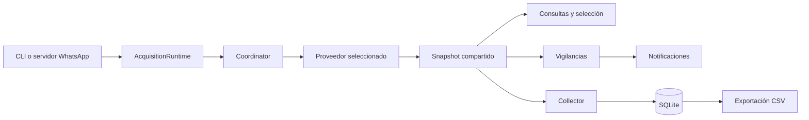

<p align="center">
  
</p>

<h1 align="center">GPS EMI</h1>

<p align="center">
  <strong>Consultas de ubicación, vigilancia de llegadas y campañas de observación GPS.</strong><br>
  Un sistema Python con acceso por WhatsApp y consola, adquisición compartida y persistencia en SQLite.
</p>

<p align="center">
  <a href="#capacidades">Capacidades</a> ·
  <a href="#arquitectura">Arquitectura</a> ·
  <a href="#instalación">Instalación</a> ·
  <a href="#calidad-y-evidencia">Calidad y evidencia</a> ·
  <a href="docs/README.md">Documentación</a>
</p>

---

## El problema que resuelve

Consultar repetidamente un portal GPS para conocer una posición o esperar un regreso
consume atención operativa. GPS EMI reúne esas tareas en comandos de WhatsApp y
consola: consultar una ambulancia, identificar las que reportan una sede y solicitar
un aviso cuando se detecta una llegada.

Las consultas y vigilancias reutilizan la misma adquisición. Las campañas permiten
conservar observaciones en SQLite y exportarlas para análisis, sin convertir cada
interacción del usuario en una nueva petición al proveedor.

Es un sistema implementado y desplegable, con CLI, servidor WSGI y contenedor
Docker. Esta presentación describe el código local hasta `a8f3f24` (14 de octubre
de 2026), revisado documentalmente el 20 de octubre. No identifica la imagen que
está ejecutándose en Oracle ni certifica disponibilidad o entrega de mensajes.

## Capacidades

| Capacidad | Alcance implementado |
|---|---|
| Consulta por móvil, placa o sede | En modo oficial, flotas cuyo nombre empieza por `Ambulancias`; selección explícita de identidades ambiguas en WhatsApp |
| Vigilancias | Múltiples por propietario en WhatsApp e individual en CLI; exclusivamente Medellín, sedes Poblado y Taller |
| Alta reportada dentro | Confirmación previa; al aceptar exige salida nueva y fresca antes de una llegada o recuperación interior |
| Continuidad | Bloqueo de llegadas con GPS de más de 300 s, recuperación diferenciada y vencimiento por inactividad con pausas de adquisición |
| Catálogo oficial | Identidad `VEH_ID`, etiquetas vigentes y eventos confirmados de ausencia/reaparición |
| Campañas | Captura nacional oficial, deduplicación durable, históricos fuera de orden, exportación CSV y reanudación sin extender el plazo |
| Servicio | Webhook firmado, autorización de remitentes, colas acotadas, logs y `/health` de liveness |

La llegada se decide por los nombres exactos de `Zones`, no por distancias ni
polígonos propios. Una posición reportada no garantiza presencia física actual.

## Arquitectura

**Una adquisición central; varios consumidores del mismo snapshot.** El diseño
separa transporte, identidad, reglas de vigilancia, persistencia y notificación.



En modo oficial, el catálogo se actualiza antes de publicar el snapshot.
`AcquisitionRuntime` controla la exclusión local y `Coordinator` planifica las
adquisiciones. Las notificaciones consumen los eventos del dominio.

El catálogo aplica al proveedor oficial. `--official` selecciona RenderExcel;
sin esa opción se usa LoadDataLog, limitado a Medellín. No hay fallback automático.
CLI y servidor deben compartir directorio de estado y ejecutarse de forma exclusiva
en una instalación. El lock local no coordina otras máquinas.
Detalles y responsabilidades: [guía del sistema](docs/guia-del-sistema.md).

## Stack técnico

| Capa | Tecnologías y responsabilidad |
|---|---|
| Aplicación | Python 3.10+, CLI y casos de uso compartidos |
| Servicio HTTP | Flask y Waitress; webhook de WhatsApp Cloud API |
| Adquisición | Adaptadores LoadDataLog / RenderExcel y coordinación central |
| Persistencia | SQLite: catálogo, observaciones y campañas |
| Distribución | Paquete Python, Dockerfile y Docker Compose |
| Verificación | pytest, transporte falso, relojes controlados y bases temporales |

## Instalación

Requiere Python 3.10 o superior según `pyproject.toml`. Desde la raíz de una copia
del proyecto, crear un entorno nuevo si aún no existe. En PowerShell:

```powershell
python -m venv .venv
.\.venv\Scripts\python.exe -m pip install -r requirements-runtime.txt
.\.venv\Scripts\python.exe -m pip install --no-deps .
.\.venv\Scripts\python.exe -m gps_emi.cli --help
.\.venv\Scripts\python.exe -m gps_emi.whatsapp.server --help
.\.venv\Scripts\python.exe -m gps_emi.collector --help
```

En Linux:

```sh
python3 -m venv .venv
.venv/bin/python -m pip install -r requirements-runtime.txt
.venv/bin/python -m pip install --no-deps .
.venv/bin/python -m gps_emi.cli --help
```

Los requirements fijan versiones de dependencias; su disponibilidad y una instalación
limpia no se verificaron en este incremento documental. Las ayudas deben terminar
con código 0 sin adquirir GPS. No prueban credenciales ni integración externa.
Para desarrollo, instalar `requirements-dev.txt` y después `pip install --no-deps -e .`
con el Python del entorno; ejecutar `python -m pytest -q`. Las pruebas usan transporte
falso y bases temporales. Véase [alcance de verificación](docs/auditoria-documental.md).

Antes de arrancar, configurar localmente las variables de [operación](docs/operacion.md):
credenciales y mapping complementario `Movil`/`VEH_NAM` para el oficial; sesión y estado
para el legado; credenciales, firma y remitentes autorizados para WhatsApp. No hay
valores de credenciales distribuidos. CLI y servidor leen `.env` del directorio actual
sin sobrescribir el entorno; la administración de campañas no lo carga.

Con configuración válida y una sola autoridad prevista, las entradas existentes son
`python -m gps_emi.cli --official` o `python -m gps_emi.whatsapp.server --official`.
Son alternativas: arrancarlas sí puede adquirir datos y crear/migrar SQLite.

`Dockerfile` y `compose.yaml` proporcionan despliegue local con usuario 10001,
volumen `/data` y puerto ligado a `127.0.0.1:8000`. El CMD base selecciona el legado;
el modo oficial requiere argumentos explícitos. El repositorio no incluye los
overrides privados de Oracle, un proxy HTTPS ni un supervisor del host.
Construcción, configuración y almacenamiento: [operación](docs/operacion.md).

## Calidad y evidencia

La calidad se apoya en decisiones verificables y límites documentados:

| Propiedad | Evidencia del diseño |
|---|---|
| Identidad estable | `VEH_ID` distingue vehículos; placa y móvil son etiquetas, no claves de identidad |
| Adquisición controlada | Exclusión local, planificación compartida y ausencia de HTTP independiente por consumidor |
| Decisiones con GPS fresco | Datos de más de 300 segundos no generan llegadas; repetir una observación no prueba movimiento |
| Persistencia consistente | Deduplicación durable y campañas que conservan su plazo al reiniciar |
| Acceso y notificación | Firma de webhook, remitentes autorizados y distinción entre evento, envío y entrega |
| Trazabilidad | Decisiones aprobadas, cierres de fase y auditoría documental enlazados |


Las fases 1–5 están versionadas. La [referencia de comandos](docs/comandos-whatsapp.md)
registra 1.105 pruebas offline aprobadas el 13 de octubre; el análisis puntual de
fase 6 registra 99 pruebas focalizadas el 14. Son ejecuciones históricas, no pruebas
nuevas de este cambio ni aceptación operacional completa. El operador reportó
arranque oficial y una consulta WhatsApp en Oracle; la campaña posterior aporta
evidencia parcial sin identificar de forma concluyente la imagen desplegada.

## Límites operativos

La cobertura del proveedor sigue siendo desconocida; no se detectan todos los
recortes silenciosos ni movimientos entre reportes. Las vigilancias, conversaciones
y colas en memoria se pierden al reiniciar. Aceptación por Meta no equivale a entrega;
no hay reintento durable ni coordinación distribuida. La retención técnica aprobada
sigue sin implementarse y la fase 6 permanece abierta. Los aplazamientos son
decisiones deliberadas, no funcionalidades prometidas para esta entrega.

## Documentación

| Para… | Leer |
|---|---|
| Explorar el proyecto | [Índice y estado general](docs/README.md) |
| Entender el diseño | [Guía del sistema](docs/guia-del-sistema.md) · [Decisiones aprobadas](docs/decisiones-arquitectonicas-renderexcel.md) |
| Configurar y operar | [Operación](docs/operacion.md) · [Comandos WhatsApp](docs/comandos-whatsapp.md) · [Referencia PDF](output/pdf/GPS_EMI-referencia-comandos.pdf) |
| Mantener y recuperar | [Mantenimiento](docs/manual-mantenimiento.md) · [SQLite](docs/base-de-datos.md) · [Recuperación](docs/procedimientos-recuperacion.md) |
| Revisar evidencia y pendientes | [Auditoría y plan de commits](docs/auditoria-documental.md) · [Antecedentes I1–I4](docs/antecedentes-i1-i4.md) |

## Privacidad y atribución

La documentación describe el trabajo existente con ejemplos sintéticos. EMI y
WideTech aparecen para identificar geocercas, filtros o integraciones del código;
no implican afiliación, aval ni autorización de publicación de marcas o material de
terceros. El logo de esta presentación fue aportado por el usuario para su uso
en el README; no acredita una marca oficial ni autorización de terceros. No se
incluyen datasets operativos. La revisión del historial,
fixtures y permisos de terceros continúa antes de publicar el repositorio completo.
Véase la auditoría. `.env`, bases, CSV, chats, logs y copias privadas quedan fuera.
