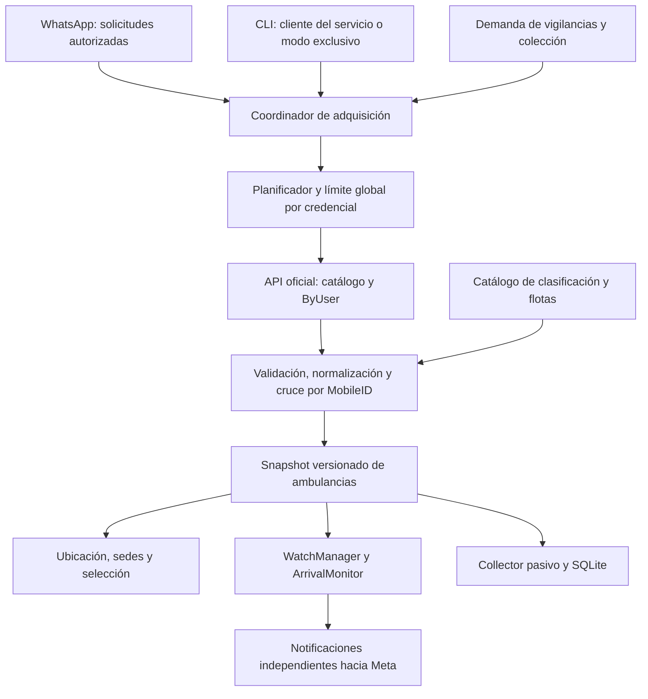

# Auditoría de integración de la API oficial WideTech

> Edición pública: identificadores sustituidos por ejemplos sintéticos (AMB-9001,
> TEST-PLATE-A y similares). En relatos de validación son seudónimos, no
> transcripciones de registros reales ni nuevas pruebas.

> **Documento histórico.** Para decisiones vigentes usar [Decisiones arquitectónicas RenderExcel](decisiones-arquitectonicas-renderexcel.md). Las propuestas y pendientes de este informe, incluida la actualización siguiente, no sustituyen la consolidación definitiva. Conservarlo como evidencia de la revisión inicial del código, no como especificación de implementación actual.

Fecha: 7 de octubre de 2026. Alcance: revisión estática del código local, documentación pública del servicio y muestras aportadas por el usuario. No se modificó código de aplicación, no se leyeron credenciales y no se hicieron consultas autenticadas ni despliegues.

**Actualización vigente tras la prueba de RenderExcel (7 de octubre de 2026)**

Esta actualización sustituye las propuestas anteriores sobre fuente principal, clasificación pendiente, frecuencia universal y cambios inmediatos en WhatsApp. El cuerpo original se conserva debajo como registro de la auditoría del código, no como especificación vigente de esos cuatro puntos.

- Fuente principal candidata: `HistoryDataLastLocationByUserRenderExcel`. La muestra real contiene posiciones, `VEH_ID`, `Movil`, `VEH_NAM`, `fltName`, `Zones`, `GPSFix` y `StateIgnition` en filas `Table` de un XML DataTable/diffgram. No requiere Excel. Validar cobertura completa, errores y campos opcionales antes de sustituir el adaptador.
- `VEH_ID` identifica al vehículo; `Id` corresponde al registro. `fltName` viene como nombre simple, por ejemplo Ambulancias Cartagena; no aplicar literalmente el sufijo del filtro LoadDataLog anterior. `VEH_DESC=CAMIONETA` no excluye ambulancias. `FechaGPS` y `FechaServidor` son Unspecified: falta confirmar zona horaria.
- Se revoca la decisión de eliminar el filtro y usar pertenencia geográfica al Valle de Aburrá. Se conserva la clasificación de la compañía; no implementar polígono metropolitano ni inferencias de flota por ubicación. El objetivo previo de abarcar ambulancias de otras ciudades se separa de su exposición operacional: conservar los datos de flota del proveedor y no ampliar silenciosamente los flujos actuales de WhatsApp en esta migración. Validar nombres reales de las flotas y alcance antes de activar una ampliación.
- Pendiente de próximo incremento WhatsApp: mostrar flota de origen, advertir flota externa/desconocida y adaptar selección/consultas para el alcance nacional. Mantener ahora la experiencia y reglas ya construidas; desacoplar la adaptación técnica de la nueva presentación al usuario. Conservar metadatos para ese incremento.
- El usuario observó límites en algunos métodos y no logró activar el límite de RenderExcel desde la página de muestra. Es evidencia exploratoria aportada por el usuario, no una medición instrumentada ni garantía de ausencia de límite. El tiempo de ejecución del método no demuestra su política de cuota.
- Retirar el requisito de 40 s como contrato universal confirmado. Mantener coordinador único, no solapamiento y configuración de intervalo por método, con posible restricción compartida por cuenta/IP si se confirma. Como configuración provisional, 40 s puede conservarse para el piloto; no está demostrado como mínimo de RenderExcel y tampoco garantiza conformidad con cualquier método de otro límite. No reducirlo ni cambiar producción con esta actualización documental.
- La documentación general menciona límites distintos según API y código funcional 109 para frecuencia excesiva. Manejar 109, HTTP 429 y Retry-After de forma diferenciada de autenticación/ausencia de vehículos, sin ráfagas de reintentos. Registrar solo método, tiempos, duración y códigos, sin credenciales ni posiciones.
- Validación pendiente: confirmar frecuencia permitida de RenderExcel y alcance del límite con WideTech o piloto acordado, midiendo intervalo entre inicios, duración, estado HTTP y código funcional. No intentar encontrar el umbral mediante una ráfaga ni interpretar respuestas HTTP 200 como éxito funcional automático.

El prompt complementario se reescribe con estas decisiones. Las afirmaciones antiguas de falta de una fuente de flota quedan superadas por la muestra de RenderExcel; todavía falta verificar cobertura y valores de todas las flotas.

---
**Conclusión de la auditoría inicial (decisiones posteriores arriba)**

La integración es viable reutilizando el monitor de llegadas, la gestión de múltiples vigilancias, la selección de vehículos y el collector. No basta con sustituir la URL y cambiar 30 por 40: hoy existen varios caminos independientes de adquisición. La nueva API debe tener un único propietario de las peticiones por credencial, compartido por todas las funciones.

El alcance solicitado es todas las ambulancias accesibles, de cualquier ciudad, excluyendo vehículos clasificados como no ambulancias. La vigilancia conserva los destinos EMI Medellin_Poblado y EMI_Medellin_Taller. Una ambulancia de otra flota debe generar una advertencia sin impedir la vigilancia. Pertenencia desconocida debe informarse como desconocida.

**Evidencia y límites**

- [ByUser JSON](https://web1ws.widetech.co/wsHistoryGetByPlate.asmx?op=HistoyDataLastLocationByUser_JSON): la documentación declara últimas posiciones de los móviles asignados al usuario y admite POST con sLogin/sPassword. Conservar la grafía exacta `Histoy`.
- [GetMobileList](https://web1ws.widetech.co/wsHistoryGetByPlate.asmx?op=GetMobileList): catálogo de móviles del usuario. Las muestras contienen VEH_ID, VEH_LCNS y VEH_NAM.
- [ByUserAttributes](https://web1ws.widetech.co/wsHistoryGetByPlate.asmx?op=HistoryDataLastLocationByUserAttributes): candidato para investigar atributos; su descripción pública NO demuestra que incluya flota o tipo de vehículo.
- El límite de 40 s procede del usuario. Falta confirmar si aplica por credencial, método o IP y si se mide entre inicios o desde la finalización. Propuesta conservadora inicial: compartirlo entre todos los métodos y esperar al menos 40 s desde la finalización antes de otra petición. Esto reduce la frecuencia efectiva; ajustar a inicios únicamente si el contrato lo confirma.
- La muestra adjunta está truncada y no es JSON completo. Los fragmentos permiten analizar campos, no certificar integridad o cobertura de toda la flota. No incorporar ubicaciones reales a fixtures versionadas.
- Se intentó `\.venv\Scripts\python.exe -m pytest -q`; Windows rechazó crear el proceso con «Acceso denegado». No se ejecutaron pruebas y no se certifica el estado actual de la suite. No fue un rechazo del revisor automático de aprobaciones.

**Mapa de conexiones existentes y cambios necesarios**

Rutas relativas a C:\GPS_EMI. Las líneas corresponden a la revisión actual y pueden cambiar.

| Conexión | Evidencia local | Cambio necesario |
|---|---|---|
| Configuración → proveedor GPS | providers/widetech.py:46–88, whatsapp/server.py:42–52, cli.py:58–61 | Nuevo adaptador oficial con configuración propia. Cookies y estado LoadDataLog dejan de ser requisitos en modo oficial. Inyectar una instancia compartida, no crear transporte y limitador nuevos por operación. |
| Vigilancias → adquisición | monitoring/fleet_polling.py:82–95 | Reutilizar el procesamiento compartido, delegando planificación y transporte en el coordinador único. No mantener dos temporizadores propietarios de llamadas. |
| Consulta ubicación → adquisición | queries.py:59–65; whatsapp/service.py:271 | Leer snapshot compartido con sus metadatos. Solicitar refresco agrupado cuando sea necesario, sin llamada directa. |
| Selección por identidad → adquisición | queries.py:74–79; whatsapp/service.py:217 | Validar MobileID seleccionado contra snapshot/catálogo actuales por el mismo camino central. Mantener protección contra selecciones caducadas o de otro usuario. |
| Inventario por sede → adquisición | queries.py:82–91; whatsapp/service.py:276 | Reutilizar snapshot; incluir ambulancias de cualquier flota que reporten la sede exacta. No equiparar origen de flota con ubicación. |
| CLI → proveedor y runner independiente | cli.py:49–74; monitoring/runner.py:125–172 | Conectar CLI al coordinador o impedir ejecución directa concurrente mediante exclusión real. Cambiar defaults no resuelve dos procesos. |
| Catálogo → identidad | resolution.py; selection.py; models.py | Incorporar MobileID, nombre visible, número de móvil y placa por separado; conservar resolución inequívoca y alias AMB9001/AMB-9001. |
| Clasificación → alcance nacional | providers/widetech.py:24,131 | Sustituir filtro fijo de Medellín por clasificación explícita de ambulancias. Incorporar flota y procedencia de clasificación. |
| Snapshot → sesiones de vigilancia | monitoring/watches.py:61–194 | Mantener estado por owner_id/MobileID y primera observación independiente; añadir advertencia de flota y semántica de calidad del snapshot. |
| Snapshot → recolección SQLite | fleet_polling.py; analysis/collector.py; analysis/sessions.py | Mantener escritura pasiva en cola; enviar snapshots nuevos una sola vez y usar acquired_at real. Migrar esquema si se añaden atributos. |
| Resultados → WhatsApp/CLI | whatsapp/formatting.py; formatting.py; whatsapp/vehicle_selection.py | Advertencia de flota ajena/desconocida, antigüedad de adquisición y del GPS, pendientes sin bloquear el worker. |
| Llegada → Meta | monitoring/watches.py; whatsapp/notifier.py; whatsapp/delivery.py; whatsapp/client.py | Conservar transporte independiente del límite GPS. Preservar modo plantilla/texto e intento de envío por vigilancia. Evaluar desacoplar envíos lentos del ciclo GPS. |
| Webhook → Inbox → MessageService | whatsapp/webhook.py; whatsapp/worker.py; whatsapp/service.py | Webhook sigue validando y encolando sin GPS. Inbox tiene un solo consumidor: no introducir espera de 40 s en handle(). |
| Arranque/cierre → servicios | whatsapp/server.py; whatsapp/shutdown.py | Crear y cerrar coordinador, catálogo y snapshot store; detener admisiones y no iniciar peticiones durante shutdown. |
| Infraestructura → persistencia | compose.yaml; Dockerfile | Una autoridad de consulta por cuenta. Compose arranca una instancia, pero no evita CLI o segundo despliegue externo. Mantener volumen y usuario sin root. |
| Métricas → diagnóstico | observability.py; whatsapp/webhook.py:health | Medir peticiones HTTP reales aparte de lecturas de caché. Health actual es liveness y no debe consumir cuota GPS. |

**Hallazgos que condicionan el diseño**

1. **El límite global hoy no existe.** FleetPolling serializa sus propios ciclos, pero las tres consultas de queries.py y WatchRunner pueden adquirir por separado. `source_factory()` construye un WideTechClient nuevo. Un lock de instancia o aumentar `--interval` no cubre esos caminos.
2. **Los defaults son incompatibles con el límite solicitado.** WatchConfig y ambas entradas usan 30 s; el backoff empieza en 5 s y llega a 30 s. El permiso de transporte debe dominar a todos los timers, incluidas reconexiones, catálogo y reintentos automáticos de librería.
3. **La espera actual es posterior a la adquisición y al procesamiento.** FleetPolling no garantiza frecuencia exacta de 30 s entre inicios; entrega de notificaciones y callbacks también consume tiempo. El nuevo diseño debe prometer intervalo mínimo, no una actualización exacta cada 40 s.
4. **La clasificación nacional aún no tiene fuente verificada.** El Vehicle actual no conserva flota. Las muestras oficiales no incluyen fltName. `@img`, prefijo AMB, ciudad en Location y coordenadas no son un catálogo autoritativo. El ejemplo previo de GetMobileList incluye una AMB con icono Incial.png: filtrar solo por icono perdería ambulancias.
5. **La identidad visible varía.** `Plate.@id` puede ser AMB-109 o una placa física; `Plate.@MobileID` es la clave para cruzar con VEH_ID. `hst.@id` no debe usarse como identidad del vehículo. El cruce debe verificarse con muestras completas coincidentes; no convertir etiquetas ambiguas en placa por heurística.
6. **No hay recuperación de vigilancias tras reinicio.** WatchManager, conversaciones, selecciones, deduplicación de Inbox y ventana de servicio están en memoria. No hay vencimiento de Watch implementado. Las sesiones de colección sí están en SQLite. No confundir ambas clases de sesiones.
7. **Fallo transitorio y terminal ya tienen efectos diferentes.** Transitorios preservan vigilancias y hacen backoff; otros fallos en FleetPolling marcan activas FAILED y bloquean la campaña de colección actual. Debe definirse clasificación de los códigos oficiales antes de mapearlos; HTTP 200 no implica status funcional 100.
8. **STALE no bloquea actualmente las llegadas.** ObservationValidator detecta duplicados, retrocesos y mezcla de fechas aware/naive. WatchManager registra STALE, GPSFix=0 y FUTURE como diagnósticos, pero un timestamp NEW continúa al monitor. Endurecer este comportamiento es una decisión de producto, no una mera adaptación del proveedor.
9. **La hora operacional es naive.** clock.operational_now elimina tzinfo deliberadamente por el proveedor anterior; acquired_at es aware. Introducir GPS aware sin adaptar consumidores produciría TIMEZONE_MISMATCH. `vehDateTimeUTC=-5.00` es una pista que requiere confirmar la semántica de DateTimeGPS/Server.
10. **Las notificaciones se ejecutan fuera del lock, pero dentro de process_snapshot.** Varios envíos lentos demoran el siguiente ciclo y el submit al collector. Un despacho separado acotado puede evitarlo, preservando reserva atómica e idempotencia. Aceptación por Meta no equivale a entrega final; no prometer exactly-once.

**Arquitectura recomendada**

El coordinador puede ser una evolución de FleetPolling o un servicio del que dependa. Debe existir una sola autoridad para iniciar HTTP. Separar transporte, límite de frecuencia, catálogo y almacenamiento de snapshots facilita probarlo sin reloj real ni red.

Contrato propuesto de snapshot: snapshot_id, acquired_at, proveedor, versión de catálogo, vehículos, resultado de adquisición y diagnósticos de cobertura/registros descartados. Los fallos no sobrescriben el último snapshot bueno como si fuera una flota vacía. Los lectores reciben copias o estructuras inmutables. La caché no actualiza acquired_at ni vuelve a insertar observaciones por cada lectura.

Demanda: vigilar, recolectar o tener una consulta pendiente activa al coordinador. Al quedar sin demanda se pausa, conservando el límite y el último snapshot. Una consulta sin snapshot devuelve estado pendiente y se resuelve después, sin bloquear Inbox. Varias solicitudes de refresco esperan una misma adquisición; colas y expiraciones deben ser limitadas y permitir cancelación/cierre.

El catálogo se obtiene al arranque si falta y se refresca con TTL configurable. Consume turno: con restricción global no se puede prometer posiciones cada 40 s y además catálogo en paralelo. Priorizar posiciones durante vigilancias y usar catálogo persistido válido; altas desconocidas quedan explícitamente pendientes hasta un refresco. Una actualización parcial/fallida no borra identidades válidas.

En un único host puede implantarse exclusión entre procesos; para varios servidores, un servicio central propietario de las credenciales y consumidores remotos. No implantar un lock local suponiendo que cubre otras máquinas. Tras reinicio, aplicar una espera inicial conservadora o recuperar una próxima fecha permitida persistida; monotonic solo es válido dentro de la vida del proceso.

**Normalización y contrato de datos**

| Origen | Destino propuesto | Regla |
|---|---|---|
| Plate.@MobileID / catálogo VEH_ID | vehid | Texto no vacío; validar coincidencia y duplicados. |
| catálogo VEH_LCNS / VEH_NAM | mobile_number / plate | Mapping observado; documentarlo y verificarlo con pares reales completos. |
| Plate.@id | provider_label | Conservar sin reemplazar identidad o inventar una placa. |
| DateTimeGPS | gps_timestamp | Parseo estricto; política horaria explícita y compatible con reloj/validador. |
| DateTimeServer | server_timestamp | Fecha del proveedor distinta de acquired_at; no representa adquisición de la app. |
| Latitude / Longitude | latitude / longitude | Números finitos y rangos válidos; inválido no se convierte en cero. Mantener diagnóstico/valor original si se decide conservar evidencia. |
| Speed / Ignition | speed / ignition | Conversión explícita; no usar bool("0"). |
| Satellites | satellites | No equivale a GPSFix; conservar gps_fix desconocido si no viene. |
| Location / PDI / ZONES | texto y zonas | Admitir string y objetos CDATA observados. Preservar raw cuando corresponda y extraer zonas exactas. |
| fuente verificada o catálogo manual | tipo y flota | ambulance/non_ambulance/unknown; Medellín/otra/desconocida. Guardar origen y fecha de clasificación. |

Soportar Plate como objeto o lista, ausencia de hst y campos opcionales, respuesta vacía válida y errores de status. Si se observan varios hst por vehículo, definir selección inequívoca por timestamp o rechazar ambigüedad, sin escoger arbitrariamente. Adaptar XML/JSON encapsulado solo según variantes observadas y probadas; nunca usar eval ni regex para reparar payload truncado.

Distinguir ZONES ausente/no interpretable de una lista explícitamente vacía. Lo primero no prueba estar fuera de EMI: convertirlo sin más a [] puede crear una salida falsa seguida de llegada falsa. Validar este punto tanto en el adaptador como en el contrato de observación.

**Vigilancias y experiencia de usuario**

- Mismo propietario y MobileID activo: devolver la vigilancia existente; distintos propietarios: sesiones independientes, compartiendo adquisición.
- La primera observación válida establece estado y no genera llegada. Una vigilancia nueva no hereda el monitor o transición de otra. Una solicitud recibida durante HTTP debe usar una política explícita de admisión, conservando el comportamiento actual de esperar otro snapshot.
- Flota externa: «Esta ambulancia pertenece a [flota]. La vigilancia buscará su llegada a EMI Poblado o EMI Taller, en Medellín». Flota desconocida: advertencia distinta; nunca afirmar que no pertenece a Medellín por falta de información.
- Ciudad actual, zona reportada y flota de pertenencia son conceptos independientes. Mantener comparación exacta de sedes y unión Poblado/Taller.
- Consultas muestran edad del GPS y edad de adquisición cuando sirvan caché. No presentar cached_at como actualización del vehículo ni ausencia en un lote parcial como inexistencia definitiva.
- La ampliación nacional aumenta ambigüedades: mostrar flota, placa y móvil cuando existan; mantener selección por ID, TTL de 300 s, aislamiento por usuario y consumo único.
- Cancelar una Watch no detiene las demás ni una campaña de recolección. Los pendientes deben poder caducar/cancelarse sin dejar suscripciones huérfanas.
- Recomiendo conservar inicialmente vigilancias en memoria y documentar la pérdida al reiniciar. Persistirlas requiere alcance explícito adicional: estado de monitor, último timestamp, destinatario, cancelación, ventana de servicio y política de recuperación/envío; no basta guardar watch_id.

**Persistencia, exportaciones y operación**

SQLite actual usa esquema de sesiones v2; almacena coordenadas, timestamps GPS, identidades y zonas, pero no flota, proveedor ni DateTimeServer. Para analizar campañas nacionales recomiendo añadir esos metadatos con migración aditiva y nullable para historia previa. No adjudicar retrospectivamente una flota actual a observaciones antiguas.

Revisar conjuntamente DATA_COLUMNS, observation(), fingerprint, SessionStore, ObservationStore y export_csv. Definir qué cambios de clasificación deben generar una observación; no modificar fingerprints accidentalmente. Mantener heartbeat y deduplicación por sesión/VEHID, cola acotada y escritura fuera del camino operacional. El colector anterior admite versiones 1/2: actualizar todos los accesos si se crea v3.

El número de ambulancias nacional no se conoce. Medir tamaño/latencia del lote, duración de normalización, memoria de copias, saturación de cola, crecimiento SQLite y tiempo de envíos antes de estimar capacidad. No afirmar escala soportada solo porque HTTP sea una llamada.

Configuración propuesta: selección explícita de proveedor; WIDETECH_LOGIN y WIDETECH_PASSWORD; intervalo mínimo; timeouts de conexión/lectura; TTL del catálogo; ubicación del catálogo de clasificación; política de caché; modalidad de coordinador/CLI. Estos nombres son propuestas, no variables ya implementadas. La URL puede quedar fijada al servicio oficial; no enviar credenciales mediante GET, logs, errores o redirecciones.

Conservar /health como liveness local. Añadir diagnóstico de último éxito GPS, próxima adquisición permitida, antigüedad del catálogo, desconocidos/excluidos, errores funcionales, snapshots parciales, cola y espera. Las lecturas de caché no cuentan como éxitos nuevos del proveedor. No volcar la flota ni secretos a logs.

**Decisiones pendientes y valores propuestos**

| Decisión | Propuesta inicial | Evidencia pendiente |
|---|---|---|
| Alcance de 40 s | Global por credencial, desde fin; reintentos incluidos | Confirmación del proveedor sobre alcance y medición. |
| Clasificación de ambulancias y flotas | Catálogo explícito por MobileID, con fuente/fecha; desconocidos pendientes | Respuesta de Attributes u otro listado autorizado completo. |
| Hora de GPS/servidor | No adivinar UTC; política configurada, raw conservado | Contrato horario del servicio y comparación de muestras. |
| Registros parciales | Calidad por registro, sin inferir salida por datos ausentes | Semántica de campos ausentes y cobertura de ByUser. |
| Persistencia de Watch | Fuera de la primera migración, limitación visible | Si el usuario requiere recuperar vigilancias tras reinicio. |
| CLI concurrente | Consumidor del coordinador; alternativa exclusiva con bloqueo real | Elegir superficie interna/IPC y topología de despliegue. |
| STALE/FUTURE | Preservar reglas actuales, explicarlas; cambio separado si se desea | Decisión sobre cuándo impedir evaluar llegadas. |

Estas incertidumbres no impiden desarrollar contratos y pruebas sintéticas. Sí impiden afirmar que la clasificación nacional y la equivalencia temporal están listas para producción.

**Secuencia de implementación y aceptación**

1. Congelar contrato con fixtures sintéticas completas, estados funcionales conocidos y decisiones de clasificación/hora. Recuperar entorno de pruebas ejecutable.
2. Crear adaptador oficial y catálogo sin activarlos en producción. Pruebas de parsing, identidad, XML seguro y errores sin secretos.
3. Centralizar todas las adquisiciones, cubrir concurrencia, reintentos, arranque/reinicio y CLI. No dejar fallback automático que escape del límite.
4. Integrar snapshots en consultas, selección, vigilancias y collector; implementar pendientes asíncronos para WhatsApp.
5. Incorporar clasificación nacional y advertencias, metadatos y migraciones de SQLite/exportación.
6. Ejecutar suite, comprobar todos los entrypoints y hacer piloto controlado con credenciales configuradas localmente. Publicar instrucciones de despliegue y reversión; no cambiar despliegue como parte de esta auditoría.

Pruebas de aceptación imprescindibles:

- 100 solicitudes concurrentes, varios propietarios y consultas de sede producen una sola adquisición compartida por turno; todos los inicios respetan la política global.
- Catálogo, 429, timeout, 5xx, error funcional y Retry-After no permiten saltarse el límite. Sin reintentos HTTP ocultos. Reloj falso, sin sleeps reales.
- Nueva instancia de cliente no reinicia el permiso; dos procesos competidores no duplican llamadas. Reinicio o salida de inactividad conserva protección.
- AMB/placa variables, cruce por MobileID, IDs duplicados, no coincidencia de catálogo, no ambulancias y clasificación desconocida.
- CDATA/string, objeto/lista, nulos, coordenadas inválidas, GPS sin timezone verificado, zona ausente frente a vacía, JSON truncado y lote parcial.
- Dos usuarios vigilan la misma ambulancia; deduplicación por propietario, cancelación aislada, primera lectura dentro sin llegada, fuera→dentro con una sola notificación por Watch y sin intercambio de identidades.
- Caché consultada muchas veces no genera nuevas adquisiciones ni filas del collector; sin caché se encola respuesta y otros mensajes siguen procesándose.
- Campaña activa sin watches sigue adquiriendo; última watch cancelada no detiene campaña; sin demanda no hay polling continuo.
- Migración conserva historia y exportaciones; nueva flota queda trazable. Caída SQLite no detiene vigilancia.
- No regresiones de allowlist, firma webhook, selección, plantilla/texto, aislamiento de propietarios y cierre limpio.

Entregable complementario: `docs/prompt-integracion-api-oficial.md`.
