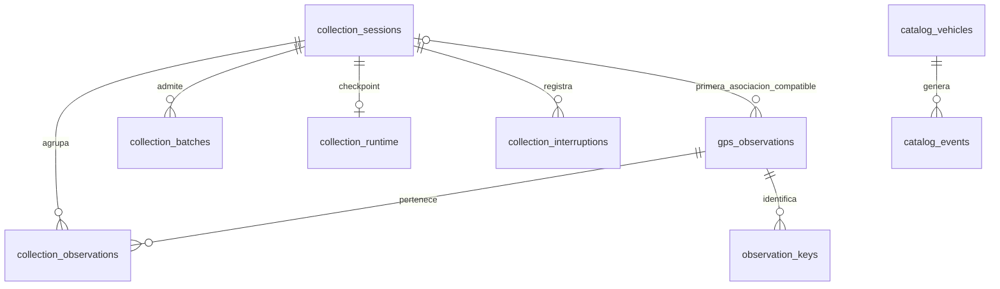
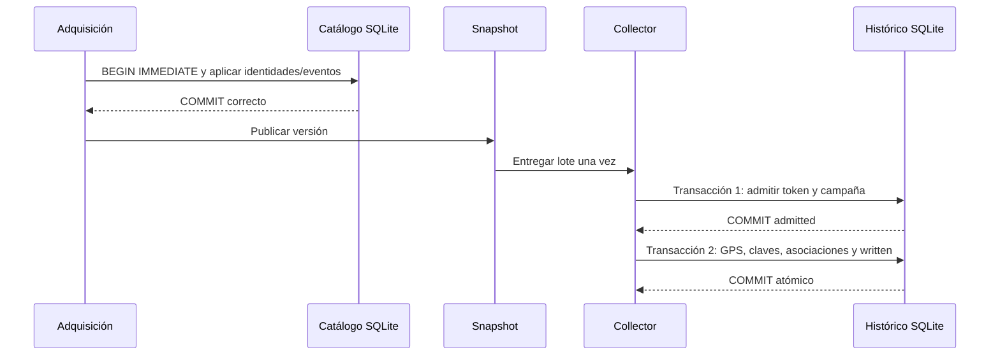

# SQLite: estructura y mantenimiento

Referencia del código hasta `0f97e1f`, revisada el 12 de octubre de 2026.
Complementa el [manual consolidado](manual-mantenimiento.md) y los
[procedimientos de recuperación](procedimientos-recuperacion.md).

## 1. Ubicación, conexión y versiones

`GPS_EMI_DATA_DB` selecciona el archivo. El defecto `data/gps_observations.db`
depende del directorio de trabajo; en una instalación mantenible usar ruta absoluta.
Docker configura `/data/gps_observations.db` sobre volumen persistente. El mismo
archivo contiene catálogo e histórico, pero son responsabilidades distintas.

`database.py` abre conexiones por operación, habilita WAL y claves foráneas y
establece 0,25 segundos de espera por bloqueo. Las escrituras que deciden estado
usan `BEGIN IMMEDIATE`: dos escritores no pueden admitir y detener una campaña
simultáneamente sin serializarse. Agotar la espera produce error, no permiso para
escribir en otra base. WAL puede generar archivos `-wal` y `-shm` junto a la base.

El histórico utiliza `PRAGMA user_version=3`; el catálogo tiene su propia tabla
`catalog_schema`, versión 1. La inicialización del catálogo acepta las versiones
compatibles del histórico sin sustituir su migración. No bajar `user_version`
manualmente. Las migraciones añaden tablas/columnas; los datos antiguos pueden
mantener metadatos NULL porque no se puede inventar su procedencia.

## 2. Relaciones



`catalog_acquisitions` identifica publicaciones por `(epoch, version)`;
`catalog_events` guarda esos mismos campos como referencia lógica, sin FK a esa
tabla. `catalog_schema` es independiente. No hay FK entre `gps_observations.vehicle_id`
y catálogo: el histórico y las bases anteriores pueden existir sin catálogo.

## 3. Diccionario de las once tablas

Los nombres siguientes son los del esquema. TEXT temporal normalizado representa
UTC ISO 8601 cuando lo genera el módulo común; los campos originales del proveedor
y registros legados conservan su semántica. No comparar indiscriminadamente fechas
originales, timestamps locales legados y UTC como si fueran equivalentes.

### gps_observations: una observación física

| Columnas | Tipo y significado |
|---|---|
| `id` | INTEGER PRIMARY KEY; identificador interno |
| `acquired_at` | TEXT NOT NULL; adquisición que originó la fila |
| `vehicle_id` | TEXT; identidad del vehículo |
| `mobile_number`, `plate` | TEXT; etiquetas observadas |
| `vehicle_name_raw`, `vehicle_license_raw` | TEXT; etiquetas originales compatibles con legado |
| `gps_reported_at` | TEXT; timestamp GPS de la representación común |
| `latitude`, `longitude`, `speed` | Columnas sin tipo SQL declarado; conservar semántica del dato, no rellenar NULL con cero |
| `ignition`, `gps_fix`, `zones` | TEXT con serialización JSON |
| `zones_raw`, `reported_location` | TEXT; geocercas originales y ubicación reportada |
| `fingerprint` | TEXT NOT NULL; huella compatible del collector |
| `collection_session_id` | TEXT, FK a campaña; primera asociación compatible con esquema anterior |
| `fleet_name`, `fleet_raw` | TEXT; flota normalizada y original de esa observación |
| `gps_original`, `server_original` | TEXT; fechas originales GPS/servidor |
| `provider_record_id` | TEXT; referencia GPS del proveedor, no identidad del vehículo |
| `provenance` | TEXT; fuente de la observación |
| `gps_instant` | TEXT; instante usado para deduplicar |
| `historical` | INTEGER; observación nueva más antigua que el máximo previamente conocido |
| `timestamp_collision` | INTEGER; mismo instante con contenido diferente |

Índices: `observations_vehicle(vehicle_id,id DESC)`,
`observations_acquired(acquired_at)` y
`observations_session_vehicle(collection_session_id,vehicle_id,id DESC)`.
No usar la columna singular de campaña para contar todas las asociaciones actuales.

### observation_keys: deduplicación durable

`key TEXT PRIMARY KEY`, `observation_id INTEGER NOT NULL` (FK a observación),
`source TEXT NOT NULL`, `vehicle_id TEXT NOT NULL`, `gps_instant TEXT NOT NULL`.
Índice `observation_time(source,vehicle_id,gps_instant)`.

La clave es SHA-256 de fuente, identidad, instante y contenido GPS relevante:
coordenadas, velocidad, encendido, GPSFix, geocercas y ubicación. No incluye etiquetas
mutables ni recepción del servidor. Renombrar no crea otro GPS; igual instante con
contenido distinto sí crea una observación marcada. No se deduplican fuentes cuya
equivalencia temporal no esté demostrada. La migración incorpora claves disponibles
del legado, pero no elimina retroactivamente todas sus filas duplicadas.

### collection_sessions: campañas

| Columnas | Tipo y significado |
|---|---|
| `id` | TEXT PRIMARY KEY, UUID |
| `started_at`, `planned_end_at`, `created_at` | TEXT NOT NULL; inicio, vencimiento original y creación |
| `stopped_at` | TEXT nullable; cierre efectivo registrado |
| `status` | TEXT NOT NULL: COLLECTING, COMPLETED o STOPPED |
| `requested_duration_seconds` | INTEGER NOT NULL; duración solicitada |
| `stop_reason` | TEXT nullable; por ejemplo duration_elapsed o manual |

Un índice único parcial permite solo una campaña COLLECTING. Al vencer se registra
COMPLETED con `stopped_at=planned_end_at`; parada manual registra STOPPED y su hora.
Consultar `status` mediante SessionStore puede materializar el vencimiento y ejecutar
migraciones: no es una herramienta forense estrictamente de solo lectura.

### collection_observations: relación muchos a muchos

`session_id TEXT NOT NULL` (FK), `observation_id INTEGER NOT NULL` (FK),
`received_at TEXT NOT NULL`; PRIMARY KEY `(session_id, observation_id)`.
Una observación física puede pertenecer a varias campañas. La fecha es su primera
recepción asociada a esa campaña. La migración importa asociaciones singulares
preexistentes. Los recuentos de campaña deben usar esta tabla.

### collection_batches: admisión durable

`token TEXT PRIMARY KEY`, `session_id TEXT NOT NULL` (FK),
`started_at`, `acquired_at`, `admitted_at` TEXT NOT NULL,
`state TEXT NOT NULL CHECK(state IN ('admitted','written'))`.
El token impide repetir una escritura ya completada. La tabla no contiene el
payload GPS: un lote admitted tras un crash no puede reconstruirse solo con ella.

### collection_runtime: contacto del collector

`session_id TEXT PRIMARY KEY` (FK), `epoch TEXT NOT NULL`,
`last_observed_at TEXT NOT NULL`. La época identifica la ejecución del collector;
su checkpoint permite reconocer cambio de proceso, no demuestra recepción GPS continua.

### collection_interruptions: ventanas sin observación de ejecución

`id INTEGER PRIMARY KEY`, `session_id TEXT NOT NULL` (FK),
`last_observed_at`, `detected_at`, `reason` TEXT NOT NULL.
Motivos: `restart_window` y `first_attachment_window`. Son límites de una ventana
posible de interrupción, no un diagnóstico exacto de caída de WideTech. No se
rellenan esos intervalos con posiciones inventadas.

### catalog_schema: versión del catálogo

`version INTEGER PRIMARY KEY CHECK(version=1)`. No sustituye `PRAGMA user_version`.

### catalog_vehicles: identificación vigente

`vehicle_id TEXT PRIMARY KEY`; `plate`, `mobile_number`, `fleet_name` TEXT nullable;
`first_seen`, `last_seen` TEXT NOT NULL;
`presence TEXT NOT NULL CHECK(presence IN ('present','disappeared'))`;
`disappeared_at`, `reappeared_at` TEXT nullable.

Estas fechas pertenecen a adquisiciones, no al GPS del vehículo. Metadata ausente
conserva la anterior. Una reaparición no borra el historial confirmado; no hay aquí
un historial independiente de renombres o cambios de flota. Tampoco se guardan
coordenadas para restaurar el snapshot tras reiniciar.

### catalog_acquisitions: idempotencia del catálogo

`epoch TEXT NOT NULL`, `version INTEGER NOT NULL`, `acquired_at TEXT NOT NULL`,
`absence_eligible INTEGER NOT NULL`; PRIMARY KEY `(epoch,version)`.
Reaplicar una versión no cuenta otra ausencia. La aptitud se decide con la política
TEC-01 del [registro aprobado](decisiones-arquitectonicas-renderexcel.md), no por porcentajes de cobertura.

### catalog_events: hechos confirmados

`id INTEGER PRIMARY KEY`, `vehicle_id TEXT NOT NULL` (FK),
`kind TEXT NOT NULL CHECK(kind IN ('disappearance','reappearance'))`,
`occurred_at TEXT NOT NULL`, `epoch TEXT NOT NULL`, `version INTEGER NOT NULL`;
UNIQUE `(vehicle_id,kind,epoch,version)`.
Son ausencia/reaparición observadas, no altas/bajas administrativas del proveedor.

## 4. Fronteras de consistencia



Si falla el catálogo no se publica el candidato y se conserva el snapshot previo.
Si el proceso cae entre commit y publicación, puede persistir catálogo que no llegó
a consumidores; tras reiniciar se requiere adquisición nueva para posiciones.
Catálogo e histórico no forman una única transacción: fallo del collector no
deshace una publicación ya válida.

La admisión comprueba inicio HTTP posterior al inicio de campaña y recepción dentro
de vigencia. Stop/vencimiento se serializan con admisión. Un token admitido puede
escribirse después del cierre; encolar antes del cierre no equivale a admitir.
El worker tiene reintento acotado de escritura con el mismo token. No hay replay
automático durable del payload tras reiniciar.

## 5. Inspección y exportación

Abrir la base existente con URI SQLite `mode=ro`; comprobar primero que existe.
No inicializar SessionStore sobre una ruta dudosa para investigar: podría crear otra
base o migrar. Estos ejemplos agregados evitan listar vehículos o coordenadas:

```sql
PRAGMA user_version;
PRAGMA quick_check;
SELECT COUNT(*) AS observations FROM gps_observations;
SELECT status, COUNT(*) AS campaigns FROM collection_sessions GROUP BY status;
SELECT state, COUNT(*) AS batches FROM collection_batches GROUP BY state;
SELECT presence, COUNT(*) AS vehicles FROM catalog_vehicles GROUP BY presence;
SELECT COUNT(*) AS associations FROM collection_observations;
SELECT COUNT(*) AS unlinked_associations
FROM collection_observations AS a
LEFT JOIN gps_observations AS o ON o.id=a.observation_id
WHERE o.id IS NULL;
```

`quick_check` y recuentos grandes pueden consumir recursos: ejecutarlos sobre una
copia cuando el tamaño lo aconseje. Una base de una fase anterior puede carecer de
tablas; verificar esquema antes de interpretar ausencia como corrupción.

CSV global filtra por `acquired_at`; CSV de campaña filtra por `received_at` de la
asociación. El intervalo es inicio inclusivo y fin exclusivo; no es filtro de fecha
GPS. Columnas originales se mantienen y metadatos se añaden. En exportación de
campaña la columna compatible de sesión representa la campaña solicitada y aparece
`session_received_at` cuando corresponde. Exportar no consulta al proveedor.

Los CSV contienen datos operativos y texto no confiable: guardarlos fuera del repo,
restringir acceso e importar como texto al abrir en hojas de cálculo. No adjuntarlos
a incidencias públicas. El exportador no sobrescribe un destino existente.

## 6. Respaldo y cambios de esquema

Usar SQLite Backup API o una copia offline coherente con todos los escritores
detenidos. Copiar solo el archivo principal mientras WAL está activo puede perder
transacciones. No borrar `-wal`/`-shm` de una base en uso. Ver el procedimiento
completo de [respaldo y restauración](procedimientos-recuperacion.md).

Conservar binario/commit compatible con cada backup. Una reversión de código no
revierte la migración; restaurar un backup pierde cambios posteriores y requiere
decisión del operador. No editar marcas de versión para forzar compatibilidad.
Retención técnica automática sigue pendiente; las claves de deduplicación, eventos
y asociaciones participan en garantías durables y no deben limpiarse indiscriminadamente.
