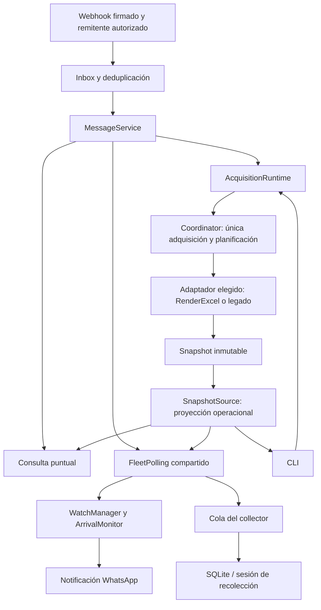

# Guía del sistema

Estado revisado el 9 de octubre de 2026: base histórica `03ee209`, fase 1
versionada en `eda2606` y adquisición central implementada en fase 2.
Ver [índice y estado](README.md) y [manual de operación](operacion.md).

## Propósito y componentes

GPS_EMI consulta posiciones reportadas de ambulancias, lista vehículos por sede,
vigila transiciones de llegada y conserva observaciones durante campañas de
recolección. La posición es la última reportada por el proveedor; no implica una
medición en tiempo real ni se calcula pertenencia por distancia o polígonos propios.

| Componente | Responsabilidad |
| --- | --- |
| `gpspace_loaddatalog.py`, `gps_emi.cli` | Consola, consultas y vigilancia individual |
| `acquisition_runtime.py`, `acquisition.py` | Autoridad exclusiva, planificación central y snapshot compartido |
| `providers/widetech.py`, `providers/load_data_log.py` | Transporte legado y Parameters dinámicos; fachada de lectura para consumidores |
| `queries.py`, `monitoring/observation.py` | Consultas y evaluación de observaciones |
| `monitoring` | Estado de llegada, vigilancias y distribución de snapshots |
| `selection` | Contextos temporales para selección explícita de candidatos |
| `whatsapp` | Webhook, comandos, conversación, presentación y envío a Meta |
| `collector.py`, `analysis` | CLI de sesiones, escritura SQLite y exportaciones |
| `clock.py`, `observability.py` | Tiempo y registros operativos |
| `providers/widetech_official.py` | Adaptador RenderExcel integrado por composición explícita con `--official` |

Los módulos se encuentran bajo `src/gps_emi`. El dominio no requiere WhatsApp
para decidir una llegada. La presentación limpia el HTML visible sin convertir
ese texto en una identidad técnica.

## Flujo operacional

El webhook no consulta GPSpace. Inbox procesa comandos fuera de la petición HTTP.
Coordinator es el único planificador y propietario del transporte GPS.
FleetPolling distribuye publicaciones entre altas, vigilancias y collector;
consultas y WatchRunner leen SnapshotSource. AcquisitionRuntime reserva exclusión
local: CLI y servidor no operan simultáneamente con el mismo directorio de estado.
No hay IPC ni coordinación automática entre instalaciones o hosts.

Sin solicitudes pendientes, altas, vigilancias ni campaña activa, el coordinador
espera sin adquirir flota.
Una campaña activa permite adquirir aunque ningún usuario esté vigilando.

## Contrato de datos e identidad

En el flujo LoadDataLog, `Vehicle` conserva `vehid`, `plate`, `mobile_number`,
`gps_timestamp`, `location`, `speed`, `ignition`, `gps_fix`, `zones`, coordenadas
y campos originales `zones_raw`, `vehicle_name_raw`, `vehicle_license_raw`.

La correspondencia **observada y utilizada por EMI/GPSpace** es:

| Origen legado | Modelo |
| --- | --- |
| `VEHID` | `vehid` |
| `VEH_NAM` | `plate` |
| `VEH_LCNS` | `mobile_number` |

No es una garantía universal de WideTech. La flota operacional se restringe
exactamente a `Ambulancias Medellin;44986;0` en el legado.

En RenderExcel, `VEH_ID` es identidad y `Id` identifica el registro GPS.
El mapping `WIDETECH_PLATE_FIELD`/`WIDETECH_MOBILE_FIELD` debe asignar
explícitamente Movil y VEH_NAM, sin deducir placas por formato. Snapshot conserva
originales, diagnósticos y procedencia; una fila inválida no congela las válidas.
Las filas anteriores conservadas mantienen su versión y edad y no alimentan
nuevas observaciones de vigilancias/collector. Cobertura siempre desconocida.
La proyección oficial actual acepta Ambulancias Medellín/Medellin. Las consultas
y campañas nacionales están aprobadas para fases 3 y 4; las vigilancias continúan
restringidas a Medellín. No se confunde ausencia con reclasificación.

La resolución acepta placa o número de móvil, elimina espacios exteriores e
ignora mayúsculas. El alias `amb20` permite encontrar `AMB-20`; no transforma
arbitrariamente cualquier placa o nombre. La ausencia se informa y la ambigüedad
no se resuelve por fecha, GPSFix o preferencia de nombres. La consola la rechaza;
WhatsApp ofrece candidatos numerados y continúa por VEHID exacto.

Los contextos de selección duran cinco minutos, pertenecen a un propietario y
se consumen una vez. Los números se interpretan en la lista vigente; no contienen
la identidad del mensaje que el usuario estaba mirando. Ver
[selección explícita](vehicle-selection.md).

El parser elimina markup HTML de las zonas antes del dominio. Después se comparan
exactamente `EMI Medellin_Poblado` y `EMI_Medellin_Taller`. No se hace búsqueda
aproximada. Location conserva su original y se limpia para mostrarla en WhatsApp.

## Llegadas y estado

La primera observación dentro de una sede establece el estado, **no genera una
llegada retroactiva**. Se informa que ya estaba dentro y se permite cancelar la
vigilancia. Para una llegada posterior debe observarse OUTSIDE → INSIDE. Cambiar
entre sedes sin observar exterior no equivale a esa transición; una pertenencia
ambigua a ambas sedes no fuerza una sede ganadora.

Timestamps duplicados, fuera de orden, ausentes o incompatibles se rechazan para
la evolución del monitor. STALE sigue siendo diagnóstico en el comportamiento
transitorio de fase 2; impedir llegadas con datos antiguos está aprobado para
fase 5 (VIG-10). GPSFix=0 mantiene su política diagnóstica independiente.
Ausencia o duplicidad de identidad no constituye salida.

Las vigilancias son únicas por propietario + VEHID mientras están ACTIVE. Sus
estados terminales son COMPLETED, CANCELLED y FAILED. El gestor protege estado
con locks y ejecuta notificaciones fuera del lock. Al detectar llegada reserva
un intento de envío: aceptación por Meta no confirma entrega y no hay reintento
durable automático. Las vigilancias y conversaciones se pierden al reiniciar.

## Recolección y tiempo

SQLite conserva sesiones y observaciones. La migración desde el collector inicial
añade la relación de sesión sin atribuir las filas antiguas a una campaña:
`collection_session_id` permanece NULL para ellas.

Solo puede existir una sesión COLLECTING. Termina como COMPLETED al alcanzar su
fin planificado, o STOPPED por intervención. Reiniciar no prolonga la ventana:
se recupera el tiempo restante o se reconoce la expiración. Consultar `status`
puede inicializar/migrar el esquema y actualizar una expiración.

El collector recibe copias por una cola limitada y escribe en su propio hilo;
no incorpora un cliente GPS adicional. Guarda cambios y un heartbeat de datos
idénticos (300 segundos por defecto) por sesión y vehículo. Revalida la ventana
al escribir y descarta muestras que lleguen después de cierre/expiración. Cola
saturada o errores SQLite pueden perder muestras sin detener las vigilancias.

SQLite usa WAL y transacciones cortas. La sesión y adquisición se registran en
UTC con zona; la presentación usa America/Bogota. El timestamp GPS heredado de
LoadDataLog puede carecer de zona: no debe reinterpretarse como UTC por comodidad.
Ver [sesiones](collection-sessions.md) y [collector](gps-collector.md).

## Fallos y observabilidad

Coordinator aplica intervalo, backoff progresivo, recuperación gradual y
Retry-After. Los consumidores no reintentan HTTP por su cuenta. En el oficial,
fallos globales conservan el último snapshot; errores individuales restringen
solo su fila. Autenticación/autorización del método bloquean nuevos intentos.
Un error local o del método no demuestra caída general de WideTech.
En el legado, una sesión GPSpace expirada es
terminal para las vigilancias y requiere intervención externa. El coordinador
bloquea la demanda de colección de esa sesión tras un fallo terminal para evitar
reintentos continuos; COLLECTING por sí solo no acredita adquisición exitosa.
Tras reparar autenticación, reiniciar permite recuperar una campaña aún vigente.

Los logs distinguen adquisición, diagnósticos y cambios de estado; resúmenes
periódicos agregan contadores del proceso. `/health` comprueba liveness local,
no autenticación, frescura GPS, entrega WhatsApp ni salud de SQLite.

## Camino hacia servicios oficiales

La fase 1 (`eda2606`) aportó el adaptador RenderExcel con parsing XML/SOAP,
errores tipados y pruebas sintéticas. Fase 2 lo conecta mediante `--official`
a la autoridad central existente, conservando consultas, resolución, selector,
vigilancias y collector. No hay fallback a LoadDataLog ni activación implícita.

Identidad VEH_ID, cobertura nacional por fases, geocercas EMI y zona inicial
America/Bogota ya están decididas. Falta verificar detalles técnicos de etiquetas
y variantes reales (TEC-02), criterio de parcialidad para fase 3 (TEC-01) y
límites externos: cuota efectiva y envoltura de errores RenderExcel. El intervalo
aprobado es 30 segundos configurable; no certifica la cuota del proveedor.

La evidencia CLI reportada por el usuario el 9 de octubre es distinta de las
pruebas offline. No acredita llegada real, entrega WhatsApp, cobertura nacional,
Docker ni Ubuntu. La restauración de vigilancias sigue aplazada deliberadamente.
Ver [fase 2](widetech-official-phase2-spec.md) y el
[registro aprobado](decisiones-arquitectonicas-renderexcel.md).
