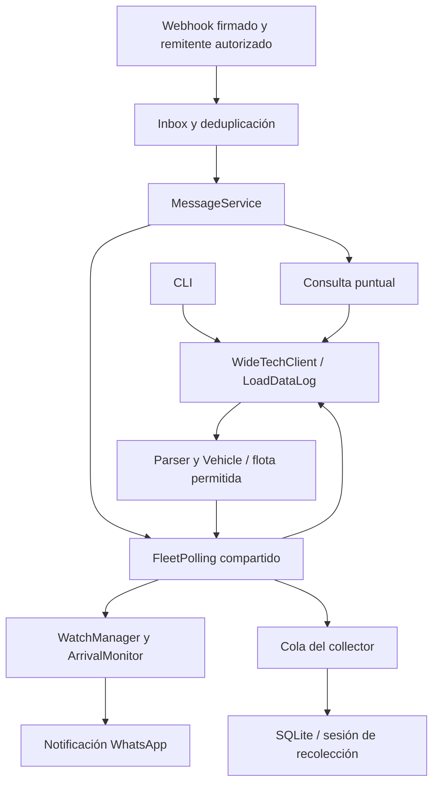

# Guía del sistema

Estado revisado el 8 de octubre de 2026: base operacional `03ee209` y fase 1
oficial confirmada en `eda2606`.
Ver [índice y estado](README.md) y [manual de operación](operacion.md).

## Propósito y componentes

GPS_EMI consulta posiciones reportadas de ambulancias, lista vehículos por sede,
vigila transiciones de llegada y conserva observaciones durante campañas de
recolección. La posición es la última reportada por el proveedor; no implica una
medición en tiempo real ni se calcula pertenencia por distancia o polígonos propios.

| Componente | Responsabilidad |
| --- | --- |
| `gpspace_loaddatalog.py`, `gps_emi.cli` | Consola, consultas y vigilancia individual |
| `providers/widetech.py`, `providers/load_data_log.py` | Adquisición operacional y Parameters dinámicos |
| `queries.py`, `monitoring/observation.py` | Consultas y evaluación de observaciones |
| `monitoring` | Estado de llegada, vigilancias y polling compartido |
| `selection` | Contextos temporales para selección explícita de candidatos |
| `whatsapp` | Webhook, comandos, conversación, presentación y envío a Meta |
| `collector.py`, `analysis` | CLI de sesiones, escritura SQLite y exportaciones |
| `clock.py`, `observability.py` | Tiempo y registros operativos |
| `providers/widetech_official.py` | Adaptador oficial aislado, todavía sin integración |

Los módulos se encuentran bajo `src/gps_emi`. El dominio no requiere WhatsApp
para decidir una llegada. La presentación limpia el HTML visible sin convertir
ese texto en una identidad técnica.

## Flujo operacional

El webhook no consulta GPSpace. Inbox procesa comandos fuera de la petición HTTP.
Un hilo FleetPolling comparte cada snapshot entre altas, vigilancias activas y
collector. Las consultas puntuales y la consola tienen adquisiciones propias:
no existe un coordinador global de cuota entre todas las rutas o procesos.

Sin altas, vigilancias ni campaña activa, el polling espera sin adquirir flota.
Una campaña activa permite adquirir aunque ningún usuario esté vigilando.

## Contrato de datos e identidad

En el flujo LoadDataLog, `Vehicle` conserva `vehid`, `plate`, `mobile_number`,
`gps_timestamp`, `location`, `speed`, `ignition`, `gps_fix`, `zones`, coordenadas
y campos originales `zones_raw`, `vehicle_name_raw`, `vehicle_license_raw`.

La correspondencia **observada y utilizada por EMI/GPSpace** es:

| Origen | Modelo | Ejemplo observado no sensible |
| --- | --- | --- |
| `VEHID` | `vehid` | `433909` |
| `VEH_NAM` | `plate` | `PJU886` |
| `VEH_LCNS` | `mobile_number` | `AMB-20` |

No es una garantía universal de WideTech. La flota operacional se restringe
exactamente a `Ambulancias Medellin;44986;0`.

La resolución acepta placa o número de móvil, elimina espacios exteriores e
ignora mayúsculas. El alias `amb20` permite encontrar `AMB-20`; no transforma
arbitrariamente cualquier placa o nombre. La ausencia se informa y la ambigüedad
no se resuelve por fecha, GPSFix o preferencia de nombres. La consola la rechaza;
WhatsApp ofrece candidatos numerados y continúa por VEHID exacto.

Los contextos de selección duran cinco minutos, pertenecen a un propietario y
se consumen una vez. Los números se interpretan en la lista vigente; no contienen
la identidad del mensaje que el usuario estaba mirando. Ver
[selección explícita](vehicle-selection.md).

El parser elimina markup HTML de las zonas antes del dominio. Después se comparan
exactamente `EMI Medellin_Poblado` y `EMI_Medellin_Taller`. No se hace búsqueda
aproximada. Location conserva su original y se limpia para mostrarla en WhatsApp.

## Llegadas y estado

La primera observación dentro de una sede establece el estado, **no genera una
llegada retroactiva**. Se informa que ya estaba dentro y se permite cancelar la
vigilancia. Para una llegada posterior debe observarse OUTSIDE → INSIDE. Cambiar
entre sedes sin observar exterior no equivale a esa transición; una pertenencia
ambigua a ambas sedes no fuerza una sede ganadora.

Timestamps duplicados, fuera de orden, ausentes o incompatibles se rechazan para
la evolución del monitor. STALE y GPSFix=0 son diagnósticos: no descartan por sí
solos una observación nueva. Ausencia o duplicidad de VEHID no constituye salida.

Las vigilancias son únicas por propietario + VEHID mientras están ACTIVE. Sus
estados terminales son COMPLETED, CANCELLED y FAILED. El gestor protege estado
con locks y ejecuta notificaciones fuera del lock. Al detectar llegada reserva
un intento de envío: aceptación por Meta no confirma entrega y no hay reintento
durable automático. Las vigilancias y conversaciones se pierden al reiniciar.

## Recolección y tiempo

SQLite conserva sesiones y observaciones. La migración desde el collector inicial
añade la relación de sesión sin atribuir las filas antiguas a una campaña:
`collection_session_id` permanece NULL para ellas.

Solo puede existir una sesión COLLECTING. Termina como COMPLETED al alcanzar su
fin planificado, o STOPPED por intervención. Reiniciar no prolonga la ventana:
se recupera el tiempo restante o se reconoce la expiración. Consultar `status`
puede inicializar/migrar el esquema y actualizar una expiración.

El collector recibe copias por una cola limitada y escribe en su propio hilo;
no incorpora un cliente GPS adicional. Guarda cambios y un heartbeat de datos
idénticos (300 segundos por defecto) por sesión y vehículo. Revalida la ventana
al escribir y descarta muestras que lleguen después de cierre/expiración. Cola
saturada o errores SQLite pueden perder muestras sin detener las vigilancias.

SQLite usa WAL y transacciones cortas. La sesión y adquisición se registran en
UTC con zona; la presentación usa America/Bogota. El timestamp GPS heredado de
LoadDataLog puede carecer de zona: no debe reinterpretarse como UTC por comodidad.
Ver [sesiones](collection-sessions.md) y [collector](gps-collector.md).

## Fallos y observabilidad

Timeouts y fallos recuperables aplican backoff. Una sesión GPSpace expirada es
terminal para las vigilancias y requiere intervención externa. El coordinador
bloquea la demanda de colección de esa sesión tras un fallo terminal para evitar
reintentos continuos; COLLECTING por sí solo no acredita adquisición exitosa.
Tras reparar autenticación, reiniciar permite recuperar una campaña aún vigente.

Los logs distinguen adquisición, diagnósticos y cambios de estado; resúmenes
periódicos agregan contadores del proceso. `/health` comprueba liveness local,
no autenticación, frescura GPS, entrega WhatsApp ni salud de SQLite.

## Camino hacia servicios oficiales

La fase 1 versionada incorpora un cliente del método
`HistoryDataLastLocationByUserRenderExcel` con configuración explícita, transporte
HTTP y parser XML/SOAP, errores tipados y pruebas sintéticas. No lee `.env`, no
reintenta ni hace fallback a LoadDataLog. Conserva procedencia y datos originales;
no transforma todavía los registros oficiales al Vehicle operacional.

Quedan por acordar y probar el mapeo de identidad, cobertura de flota, zonas,
fechas y cuotas. El cierre de fase 1 incorpora la envoltura de estado documentada
y clasificación de códigos funcionales; no se infieren códigos de textos libres.
No asumir que un intervalo universal de 40 segundos esté validado para este método.

Antes de conectar el adaptador se necesitan contratos contrastados con el
proveedor, coordinación de adquisiciones y aceptación controlada. Autenticación
automática del portal, renovación de cookie y bypass de Turnstile no existen.
La API/autenticación soportada por WideTech sigue siendo el destino preferido.
Ver [fase 1](widetech-official-phase1.md) para límites y validación registrados.
