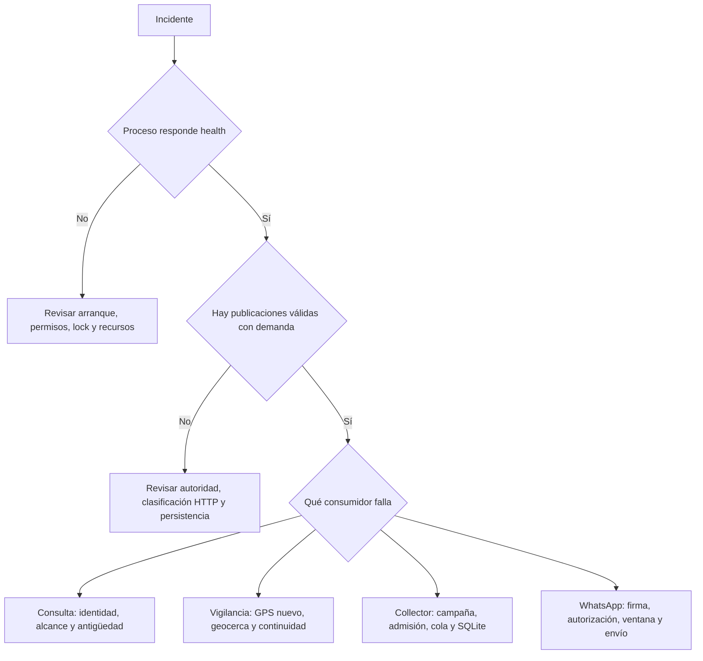

# Operación ante incidentes y recuperación

Revisado el 12 de octubre de 2026 para fases 1–5. Estos procedimientos no se han
ejecutado contra producción al redactar el manual. Leer primero la
[arquitectura](guia-del-sistema.md) y el [esquema SQLite](base-de-datos.md).

## 1. Primera respuesta

Registrar hora y zona, versión desplegada, modo oficial/legado, síntoma, categoría
de error, última publicación exitosa y alcance afectado. Usar métricas agregadas.
No adjuntar `.env`, cookies, tokens, firmas, cuerpos HTTP/XML, teléfonos, coordenadas
o flota completa. No ejecutar `docker compose config`, `env` o inspecciones completas
de contenedor para compartir salidas: pueden expandir secretos.



`/health` es liveness local. Un contenedor healthy puede no tener credenciales
válidas, demanda, campaña activa o capacidad de persistir. No iniciar una segunda
CLI de adquisición para probar mientras el servidor está activo.

## 2. Diagnóstico por síntoma

| Síntoma | Comprobar sin exponer datos | Acción y criterio de recuperación |
|---|---|---|
| No inicia por permisos de estado | Ruta absoluta y permisos del usuario efectivo; en Docker UID 10001 y montaje `/data` | Corregir propiedad/permisos de la ubicación prevista; no ejecutar como root ni cambiar de lock para eludir el error |
| Autoridad ya activa | Proceso propietario y misma instalación | Usar un solo servidor o CLI; esperar cierre de HTTP en curso |
| Estado corrupto | Detener intentos de arranque; preservar archivo restringido | Investigar/restaurar estado conocido con operador; no borrar ni inventar plazo para forzar llamadas |
| Aparente base vacía | Ruta absoluta, cwd, volumen y versión | Reconectar la base prevista; no migrar/copiar sobre archivos desconocidos |
| No hay HTTP | Demanda, intervalo pendiente, backoff o bloqueo terminal | Crear demanda legítima dentro del piloto; ausencia de demanda no es caída |
| 401/403 o error terminal oficial | Categoría segura y configuración seleccionada | Verificar credenciales/permisos por canal seguro; reiniciar controladamente tras corregir, sin fallback legado |
| HTTP 500/timeout/429 | Clasificación, frecuencia, Retry-After y último éxito | Respetar backoff; no añadir reintentos manuales ni inferir login inválido de un 500 |
| XML inválido | Tipo global del fallo, sin cuerpo operacional | Conservar snapshot; reproducir con fixture sintético antes de tocar parser |
| Vehículo no se actualiza, otros sí | Diagnósticos de fila, identidad duplicada, campos requeridos y GPS fuera de orden | Mantener dato previo con edad; corregir causa sin desactivar validaciones globalmente |
| SQLite locked/full/readonly | Espacio, permisos del directorio, otros escritores y ruta real | Corregir causa; catálogo no publica hasta persistir; collector puede fallar independientemente |
| Campaña sin nuevas filas | Estado/plazo, adquisición posterior al alta, GPS repetido y asociaciones | Repetición puede producir cero filas nuevas correctamente; comparar asociaciones, no solo filas físicas |
| Lotes admitted sin written | Conteo agregado, reinicio y errores de escritura | Investigar pérdida de payload; no marcar written a mano ni inventar observaciones |
| No llega aviso de vigilancia | GPS nuevo/fresco, geocerca exacta, continuidad, reclasificación y estado final | Reproducir regla con datos sintéticos; primera lectura interior no genera llegada |
| Webhook 403/400 | Firma del cuerpo original, destinatario y formato | Corregir integración segura; no desactivar firma |
| Webhook 503 | Saturación de inbox y worker | Corregir bloqueo/capacidad; no interpretar 200 posterior como entrega al usuario |
| Consulta funciona, aviso no | Ventana, plantilla, categoría de envío y estado de vigilancia | Presencia recuperada requiere texto dentro de ventana; fallo no reactiva vigilancia |

## 3. Reinicio controlado

1. Identificar versión, modo y rutas persistentes sin mostrar valores secretos.
2. Avisar al operador de que las vigilancias, selecciones, solicitudes y ventana de
   servicio en memoria se perderán. Campañas vigentes sí reanudan, sin ampliar plazo.
3. Enviar cierre normal al servicio. No iniciar sustituto hasta terminar el proceso
   anterior y su petición en curso. El lock no coordina otro host.
4. Conservar volumen de datos y estado. No usar eliminación de volúmenes como reinicio.
5. Arrancar una sola autoridad con los mismos montajes y usuario.
6. Verificar liveness, nueva publicación con demanda legítima, catálogo y campaña.
   Volver a crear vigilancias solo mediante solicitud explícita del usuario.
7. Registrar ventana de interrupción y resultado; no atribuir automáticamente el
   hueco al proveedor. Revisar lotes pendientes y errores de escritura.

No ampliar timeouts o apagar validaciones para ocultar una saturación. Si el cierre
forzado fue inevitable, dejar constancia de posible pérdida de colas en memoria.

## 4. Copia de seguridad consistente

Respaldar SQLite, configuración secreta por un mecanismo protegido independiente,
versión del binario y configuración no secreta de montaje. El archivo de estado
contiene plazo, no historial GPS; preservarlo en reinicios normales. Una copia de
SQLite no restaura vigilancias ni payloads encolados.

El siguiente script usa Backup API y no imprime filas. El operador debe proporcionar
rutas absolutas, crear previamente un directorio privado de backups y restringir
sus permisos. No usar una carpeta del repositorio. Puede trabajar con una base
activa; para una recuperación de incidente conviene detener escritores y conservar
además los archivos originales sin alterarlos.

```python
# Ejecutar como script: python backup_sqlite.py RUTA_DB RUTA_BACKUP_NUEVO
import sqlite3
import sys
from pathlib import Path

source = Path(sys.argv[1])
target = Path(sys.argv[2])
if not source.is_absolute() or not target.is_absolute():
    raise SystemExit("Se requieren rutas absolutas")
if not source.is_file() or not target.parent.is_dir():
    raise SystemExit("Origen o directorio de destino inexistente")
if source.resolve() == target.resolve():
    raise SystemExit("Destino igual al origen")
target.touch(exist_ok=False)  # Nunca sobrescribir un backup
with sqlite3.connect(source.resolve().as_uri() + "?mode=ro", uri=True) as src:
    with sqlite3.connect(target) as dst:
        src.backup(dst)
        valid = dst.execute("PRAGMA quick_check").fetchone() == ("ok",)
if not valid:
    raise SystemExit("Copia no validada; conservarla aislada para diagnóstico")
print("Copia terminada; comprobación estructural correcta")
```

Si falla, la existencia del destino no demuestra un backup válido. Conservarlo
identificado como incompleto y repetir con otro nombre después de corregir la causa.
Probar periódicamente restauración sobre una copia aislada sin autoridad HTTP ni
credenciales operativas. `quick_check` no prueba semántica de todos los datos ni
compatibilidad de un binario antiguo.

## 5. Restauración o reversión

1. Elegir backup verificado y commit compatible; cuantificar qué datos posteriores
   se perderían. La restauración reemplaza estado y exige decisión del operador.
2. Detener todos los escritores, incluidos comandos administrativos del collector.
3. Preservar la base averiada y sus WAL/SHM como conjunto; no borrar sidecars de una
   base activa ni mezclarlos con otra copia.
4. Restaurar en ubicación separada y verificar integridad, versión, tablas y recuentos
   agregados. No bajar marcas de esquema para que un binario antiguo la acepte.
5. Preparar permisos para el usuario de ejecución y conmutar la ruta en mantenimiento.
6. Reanudar una sola autoridad conservando la protección del plazo de adquisición.
7. Confirmar campaña y vencimiento original, publicación nueva y ausencia de errores.
   Las ausencias provisionales reinician; las confirmadas del backup permanecen.

No ejecutar herramientas de reparación sobre el único original. Si hay corrupción,
trabajar con copias y revisar recuperación especializada antes de volver a servicio.

## 6. Administración de campañas

Los comandos siguientes son plantillas; sustituir rutas e identificador y ejecutarlos
solo sobre la instalación elegida. Administran SQLite, no crean otra autoridad GPS.
No cargan automáticamente el `.env` como lo hace el servidor: pasar `--db` absoluto.

```text
python -m gps_emi.collector --db RUTA_ABSOLUTA_DB start --duration 24h
python -m gps_emi.collector --db RUTA_ABSOLUTA_DB status
python -m gps_emi.collector --db RUTA_ABSOLUTA_DB stop
python -m gps_emi.collector --db RUTA_ABSOLUTA_DB export --session UUID --output RUTA_CSV_NUEVO
```

`start`, `status` y `stop` pueden crear/migrar o actualizar estado; no usarlos como
sonda forense sobre una ruta sin verificar. El exportador lee y exige destino nuevo.
Duraciones admiten entero positivo con s/m/h/d; no extender una campaña existente
para compensar una interrupción. Las exportaciones requieren protección de datos.

## 7. Piloto real acotado

Usar credenciales oficiales mediante el mecanismo seguro de la instalación. No
copiarlas al manual, terminal compartida o fixtures. Acordar una ventana breve
—por ejemplo diez minutos— y conservar una sola autoridad, intervalo aprobado de
30 segundos, mismo estado y misma base. Una campaña breve puede generar demanda
acotada; asegurar que no quedan vigilancias u otras demandas que prolonguen llamadas.

Registrar inicio/fin, número de intentos/publicaciones, categorías de error, filas
recibidas/utilizables/retenidas agregadas, deduplicación, escritura y cierre. Parar
ante autenticación denegada, restricción persistente del proveedor, errores repetidos
de persistencia, duplicidad de autoridades o comportamiento de vigilancia contrario
a la regla. No insistir cambiando ruta de lock, intervalo o proveedor.

Revisar mapping, antigüedad, flotas y geocercas con el operador autorizado sin volcar
la flota completa. Validar separadamente llegada normal, recuperación, ventana de
WhatsApp, permisos UID 10001, reinicio y cierre con HTTP en curso. Las pruebas de
escenarios de llegada requieren condiciones reales controladas, no simular movimiento
editando producción. Registrar qué escenarios no pudieron comprobarse.

La [guía específica de Oracle](guia-comprobaciones-oracle-fase6.md) mantiene contexto
y evidencia de esa instalación. Un piloto exitoso no elimina la limitación de
cobertura desconocida ni implementa retención pendiente.

## 8. Mantenimiento del código y parte de incidente

Para cambios de código, usar entorno de desarrollo aislado, dependencias del repo y
`python -m pytest -q`. Ejecutar primero los casos del componente afectado y después
regresión. Las pruebas deben usar datos sintéticos y bases temporales. No convertir
un fallo de entorno Python en justificación para probar sobre producción.

Parte mínimo, sin datos sensibles:

```text
Fecha/zona y versión:
Modo y componente afectado:
Síntoma y categoría segura:
Última publicación correcta / intervalo afectado:
Recuentos agregados relevantes:
Acciones y motivo:
Resultado y verificación:
Datos potencialmente perdidos / comprobaciones pendientes:
Decisión arquitectónica relacionada:
```

Antes de compartir un diagnóstico o commit, revisar íntegramente archivos nuevos
y diff, excluir `.env`, bases, CSV y logs, y ejecutar detector de secretos disponible.
No desestimar una alerta sin resolverla o justificar con evidencia su carácter sintético.
