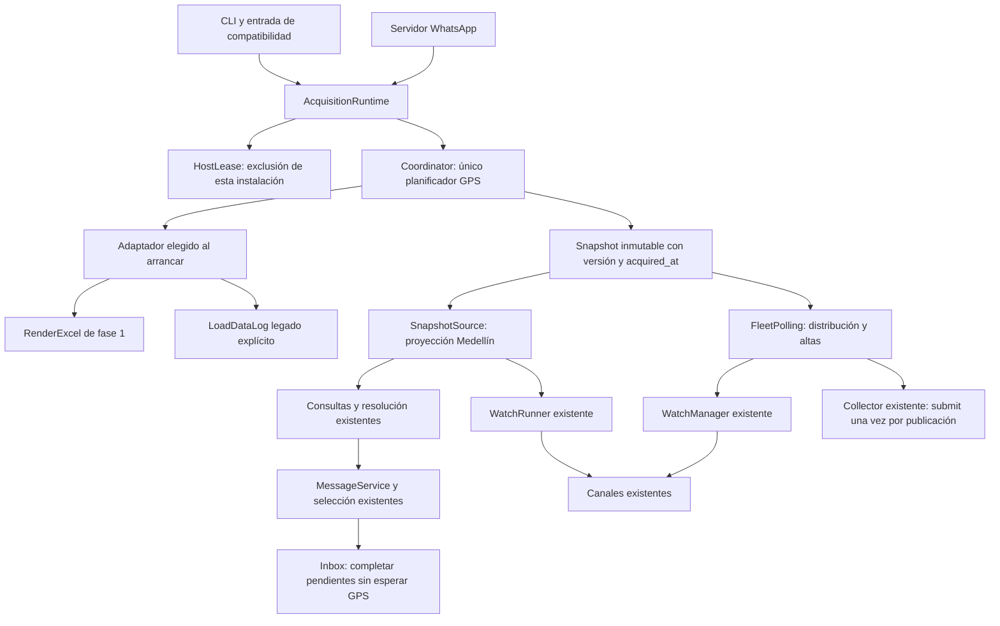

# Fase 2 — adquisición central y snapshot compartido

**Referencia consolidada:** [Decisiones arquitectónicas aprobadas](decisiones-arquitectonicas-renderexcel.md). Sus acuerdos prevalecen sobre propuestas de diseño de este documento. Consultar ARQ, DAT-08, las fases y el registro TEC; no volver a solicitar decisiones ya aprobadas.

Implementación local del encargo de fase 2, 8 de octubre de 2026, incluyendo la
indicación posterior de refactorizar la arquitectura existente. Sustituye la
propuesta anterior de este documento; no modifica los acuerdos arquitectónicos.
[Contrato de fase 1](widetech-official-phase1.md). Aquel encargo se realizó sin
despliegue, llamadas reales, cambios al .env operativo, migraciones, commit ni
push. La reconciliación documental y el commit selectivo posteriores del
9 de octubre se registran por separado al final de la evidencia.

Este documento conserva el alcance y evidencia del cierre de fase 2. La
[implementación local de fase 3](widetech-official-phase3.md) amplía consultas
a nivel nacional e incorpora catálogo persistente y reclasificaciones; las
limitaciones de alcance descritas abajo corresponden al incremento anterior.

## Arquitectura final y responsabilidad extraída

Las dos ramas del adaptador son alternativas **excluyentes de composición**:
solo existe una instancia, un planificador y un transporte GPS activo por runtime.
No hay fallback al otro adaptador después de un fallo. La cuota Meta sigue
siendo independiente.

| Componente | Cambio y responsabilidad |
|---|---|
| Nuevo `acquisition.py` | Extrae de FleetPolling planificación, restricciones, publicación y futures acotados. Contiene el contrato Snapshot y su proyección al Vehicle existente. |
| Nuevo `acquisition_runtime.py` | Composición, reserva entre procesos y ciclo de vida compartidos por CLI y servidor. No es un segundo servicio de negocio. |
| `monitoring/fleet_polling.py` | Conserva altas, resolución, callbacks y distribución. Se retiran HTTP, backoff y espera entre adquisiciones. Su hilo espera publicaciones/altas; el timeout de 0,2 s solo caduca altas pendientes. |
| `monitoring/runner.py` | Conserva resolución por identidad, validación temporal, monitor y notificador. Espera versiones del coordinador; no adquiere ni calcula reintentos. |
| `monitoring/watches.py` | Misma máquina de estados. Permite evaluar solo las altas nuevas cuando reutilizan una versión ya procesada por otras vigilancias. |
| `queries.py` y presentación CLI/WhatsApp | Mismos casos de uso por etiqueta, VEH_ID y sede. Fijan un snapshot por operación y muestran hora/edad de adquisición separadas de la edad GPS. |
| `whatsapp/service.py` y `worker.py` | Una sola ruta de consultas: pendiente y posterior ejecución de los casos de uso existentes. Inbox completa resultados entre mensajes y al quedar libre; no espera HTTP ni backoff. |
| `selection.py` | Sin cambios de reglas: propietario, generación, TTL, consumo único, paginación e identidad. |
| Collector, SQLite, CSV, canales | Sin cambios de esquema, deduplicación histórica o transporte de notificaciones. Reciben la misma proyección operacional que antes. |
| `providers/widetech.py` | El antiguo transporte se identifica como LegacyWideTechTransport y solo se compone dentro de la autoridad. WideTechClient pasa a ser fachada de lectura; `load_data_log()` de compatibilidad falla sin HTTP. |
| `cli.py`, `whatsapp/server.py` | Ambos componen AcquisitionRuntime; ya no crean un cliente HTTP por operación. `gpspace_loaddatalog.py` continúa delegando a CLI. |
| `observability.py` | El resumen incorpora métricas del coordinador, sin disparar adquisiciones. |
| `.gitignore` | Conserva la exclusión histórica de `.runtime/`; la reserva nueva usa el directorio de estado configurado. |

Los adaptadores de transporte conservan sus pruebas unitarias con HTTP falso.
Los consumidores reales solo reciben SnapshotSource. No se mantienen ramas de
adquisición antiguas en FleetPolling, WatchRunner o MessageService para satisfacer
mocks anteriores; las pruebas de negocio suministran snapshots.

## Snapshot y alcance operacional

- Identificador `epoch + version`; epoch nuevo al arrancar. `acquired_at` aware
  UTC al terminar adquisición y parsing, nunca tomado de FechaGPS.
- Publicación bajo Condition, registros oficiales inmutables y proyecciones Vehicle
  mediante copias. Leer caché no cambia versión, acquired_at ni contadores de éxito.
- Conserva todas las filas oficiales, incluidas no ambulancias, procedencia,
  clasificación, campos originales y diagnósticos. `received()` permite inspeccionar
  el último lote interpretado con sus diagnósticos individuales.
- Un fallo global de transporte, XML o estructura conserva la publicación anterior.
  Un lote estructuralmente válido se publica aunque contenga filas defectuosas.
  Las validaciones del adaptador de fase 1 permanecen intactas.
- `records` conserva exactamente las filas recibidas. `usable_records` contiene
  las filas actuales sin diagnósticos, con identidad única, coordenadas, fecha GPS,
  flota y Zones conocido. Zones vacío explícito es distinto de ausente o nil.
  Una fila sin flota o con un opcional inválido solo restringe esa fila, nunca el lote.
- `operational` conserva por identidad la última fila utilizable y su epoch,
  versión, acquired_at y procedencia originales. Si la fila actual es defectuosa,
  duplicada o no recibida, se marca el motivo de conservación. No se escoge entre
  duplicados ni se mezclan campos de reportes diferentes. Se conserva la fila
  anterior completa incluso si el diagnóstico corresponde a un campo opcional:
  política conservadora por vehículo, sin impedir actualizar los demás.
- Consultas CLI/WhatsApp muestran los datos conservados con su edad original y
  una indicación explícita, también en inventarios. Vigilancias y collector solo
  reciben filas utilizables de la adquisición actual. Los datos conservados no
  producen nuevas observaciones, movimientos ni llegadas; nunca se convierten
  coordenadas ausentes en cero ni Zones desconocido en salida de una geocerca.
  Esta conciliación ocurre una vez en Coordinator y usa la misma proyección
  SnapshotSource. No introduce catálogo persistente ni recuperación de fase 5.
- `coverage=unknown` siempre: XML válido y ausencia de diagnósticos no certifican
  cobertura completa. No se inventa un porcentaje de disminución aceptable ni
  contadores de desaparición. La detección semántica adicional queda en TEC-01/fase 3.
- La proyección operacional admite exactamente `Ambulancias Medellin` y
  `Ambulancias Medellín` tras la normalización de fase 1. No amplía consultas,
  campañas ni vigilancias a todo el país en esta fase. La evidencia nacional
  permanece en el snapshot para fases posteriores.
- VEH_ID es identidad; Id permanece como registro GPS. Las etiquetas se asignan
  mediante mapping explícito Movil/VEH_NAM, sin deducir placas por formato.
- El parser usa WIDETECH_TIMEZONE, inicialmente America/Bogota. La proyección
  convierte cada instante GPS a Bogotá antes de quitar tzinfo para los consumidores
  actuales, cuyo reloj operacional es naive de Bogotá. Los originales aware se
  conservan. No se mezclan directamente timestamps aware y naive.
- Una adquisición distinta puede contener la misma observación GPS. Los validadores
  existentes siguen deduplicando observaciones por su regla actual; collector
  conserva su deduplicación histórica hasta fase 4. La advertencia por edad GPS
  mayor a 300 s se conserva, sin adelantar la nueva regla de llegadas de fase 5.
- No se leen ubicaciones de SQLite para inicializar el snapshot tras un reinicio.

## Planificación y demanda

Un único hilo ejecuta `Coordinator.tick()`. El método también permite pruebas
deterministas con reloj monotónico inyectado. La sección en vuelo permanece
reservada durante transporte, parsing, publicación y entrega a colas.

Intervalo base B = 30 s, configurable, medido entre inicios de intentos después
de reservar la exclusión. El siguiente inicio debe ser posterior al anterior + B
y a la finalización del intento en curso. Un intento largo no acumula ciclos:
solo puede seguirlo un nuevo intento, sin recuperar periodos atrasados.

Ante fallo recuperable, backoff = min(tope, max(B, backoff anterior × 2)).
El próximo inicio respeta tanto el intervalo base como finalización + backoff.
Después de un éxito, el backoff se reduce a la mitad mientras supere B;
al siguiente éxito con backoff <= B se elimina. Tope predeterminado 300 s,
nunca inferior al intervalo base.

Retry-After válido, tanto segundos como fecha HTTP, añade otra restricción;
se toma el máximo, no se reemplaza por el backoff. No hay reintentos en el
adaptador, ni una espera fija de 20 s deducida del código 109. Estos tiempos
son política local, no certificación de límites del proveedor.

Demanda: vigilancia activa, alta pendiente, campaña activa o consulta pendiente.
Sin demanda no se adquiere. Cambiar a inactivo no reinicia next_start/backoff.
Una consulta con caché responde con su edad; si tiene al menos B segundos,
encola un refresco compartido acotado. Así las consultas puntuales también
renuevan datos sin presentarlos como recién adquiridos. Un refresco explícito
espera una publicación nueva; los concurrentes comparten el intento.

## Consumidores, pendientes y errores

Sin publicación inicial, ubicación, selección por ID y sede reciben aviso de
inicialización y quedan pendientes. Hay como máximo 100 futures de adquisición,
100 consultas de MessageService (una por propietario) y 100 altas de vigilancia;
TTL predeterminado 120 s medido con reloj monotónico. La espera CLI también se
acota a 120 s y se puede interrumpir. Una consulta reemplazada o cancelada no
responde tarde: se cancela su future y se verifica la generación de PendingSelections.
La carrera entre cancelación y publicación se resuelve reclamando el future
atómicamente antes de completarlo.

Las vigilancias aceptadas son operaciones independientes, como antes: otra
solicitud de vigilancia no cancela las anteriores. CANCELAR invalida las altas
pendientes del propietario; las vigilancias ya activas conservan sus comandos
de gestión. Los selectores tardíos mantienen la validación de generación existente.

FleetPolling recibe versiones en una cola de hasta 100 elementos. Cada versión
se procesa una vez; una nueva alta que use caché se evalúa sin reprocesar las otras
vigilancias. Ante saturación se omite la versión intermedia más antigua y se registra
un aviso seguro; no se bloquea el transporte. El collector recibe un único submit
por publicación mientras la campaña está activa, incluso si el consumidor de
vigilancias está ocupado. Leer caché, seleccionar o dar de alta no llama submit.
Su propia cola y tratamiento de saturación permanecen sin cambios.

| Resultado | Tratamiento central |
|---|---|
| HTTP 500, red, timeout, XML o estructura global inválidos | Conservar último válido; backoff y Retry-After cuando exista. |
| Diagnósticos individuales o identidades duplicadas | Publicar lote y diagnósticos; actualizar filas utilizables y conservar estado anterior afectado con su origen. |
| HTTP 429 o 109 estructurado | Restricción compartida; no buscar números en texto libre. |
| 108 / autorización del método | BLOCKED_METHOD; resolver pendientes con error, no reintentar indefinidamente. |
| Autenticación/configuración y otros errores funcionales terminales | Requieren intervención/reinicio; nunca fallback. |
| Lectura de caché durante bloqueo | Disponible con acquired_at original; no modifica estado del proveedor. |

FleetPolling conserva el tratamiento existente de fallo terminal de adquisición
para vigilancias, usando su causa/mensaje existentes. No suspende vencimientos,
restaura vigilancias ni introduce causas de flota. Nuestra indisponibilidad no
demuestra una caída general de WideTech. GetMobileList no participa.
La envoltura real de 109 en RenderExcel sigue sin confirmarse: las pruebas usan
transporte/respuestas sintéticas y no se presentan como evidencia del proveedor.

## Exclusión entre procesos y cierre

Se elige **ejecución exclusiva verificable**, no IPC. CLI y servidor no pueden
poseer simultáneamente la autoridad de una misma instalación. Ambos usan
`GPS_EMI_STATE_DIR/acquisition.lock`. La variable debe ser una ruta absoluta;
una cadena vacía o relativa impide arrancar. Sin configuración explícita se usa
`%LOCALAPPDATA%/GPS_EMI` en Windows (o AppData/Local del usuario) y
`$XDG_STATE_HOME/gps-emi` en Linux (o `~/.local/state/gps-emi`). No depende del
cwd ni escribe junto al paquete instalado. CLI y servidor deben compartir
la misma configuración y usuario, o un directorio acordado y accesible a ambos.
Errores de permisos fallan cerrados; no se intenta otro lock ni elevar privilegios.

Docker configura `/data/state`, dentro del volumen persistente ya montado en
`/data`. La imagen prepara `/data` con propietario 10001:10001 y modo 700;
el proceso UID 10001 crea state. Un volumen preexistente o bind mount debe
tener esos permisos preparados por su administrador: el arranque no los cambia.
No retirar el volumen al reiniciar, pues contiene el plazo de próxima adquisición.

HostLease mantiene un bloqueo de byte con msvcrt en Windows y flock en Ubuntu.
No borra el archivo de lock ni cambia su inode. Un segundo proceso falla antes de
iniciar transporte. Guarda solo la próxima fecha UTC permitida; se reserva antes
del intento y se amplía con las restricciones recibidas. Al reiniciar, el plazo
restante se transforma de nuevo en una espera monotónica. Un archivo corrupto o
fallo al reservar impide adquirir; no se trata como permiso libre.

El lock cubre los entrypoints cooperantes de esta instalación. No coordina otras
copias, contenedores, herramientas externas ni servidores. No garantiza el estado
de una petición que siga ejecutándose remotamente tras terminar abruptamente
el proceso. UTC persistido protege reinicios ordinarios; alterar el reloj del host
entre procesos requiere intervención operativa. No se afirma liderazgo distribuido.

El runtime se construye antes de iniciar el hilo, para cerrar correctamente si
falla el arranque de otros componentes. Shutdown marca el coordinador detenido
antes de esperar consumidores: descarta pendientes y no inicia nuevos intentos.
close espera hasta 2 s al hilo GPS; si HTTP sigue en curso, conserva el lock hasta
que ese hilo termine. No intenta matar una petición desde otro hilo. El adaptador
conserva timeouts de conexión/lectura de fase 1; timeout de lectura no equivale
a un límite total de una respuesta transmitida lentamente.

## Configuración y activación posterior

La configuración oficial es independiente de GPSPACE_COOKIE. No se cambia .env
ni se activa RenderExcel por defecto en instalaciones existentes. El modo sin
`--official` selecciona el transporte legado dentro del mismo coordinador.

| Parámetro | Valor / función |
|---|---|
| `--official` | Selecciona exclusivamente RenderExcel para ese proceso. |
| `GPS_EMI_STATE_DIR` | Directorio absoluto de estado compartido por CLI/servidor; Docker `/data/state`. |
| `--interval` | Base de adquisición; 30 s por defecto. |
| `--acquisition-max-backoff` | 300 s por defecto; tope efectivo al menos igual al intervalo. |
| `WIDETECH_LOGIN`, `WIDETECH_PASSWORD` | Configuración local de autenticación, nunca registrada. |
| `WIDETECH_TIMEZONE` | America/Bogota por defecto. |
| `WIDETECH_PLATE_FIELD` | Movil o VEH_NAM, tras verificar la correspondencia real. |
| `WIDETECH_MOBILE_FIELD` | El otro campo; mapping obligatorio, sin valor inferido. |

Las opciones históricas initial-backoff/max-backoff siguen aceptándose por
compatibilidad, pero ya no gobiernan bucles de adquisición de consumidores.
El límite y TTL de pendientes se inyectan mediante AcquisitionConfig; no se añade
otra configuración operacional implícita.

Propuesta histórica de piloto WhatsApp, **no ejecutada por el agente**:
El usuario optó después por validar CLI y aplazar WhatsApp para servidor.
El procedimiento siguiente queda como referencia opcional futura, no como
requisito pendiente obligatorio para cerrar fase 2:

1. Detener la otra CLI/servidor de la misma instalación.
2. Proporcionar credenciales y mapping verificado mediante el entorno local seguro.
3. Verificar que GPS_EMI_STATE_DIR es absoluto, persistente y escribible por el
   usuario de ejecución. No borrar el lock ni su plazo para acelerar el piloto.
4. Ejecutar una sola entrada `gps-emi-whatsapp --official --interval 30`, con
   un supervisor que envíe SIGTERM a los **180 segundos**. Activar una sola
   vigilancia sobre una identidad previamente acordada para generar demanda.
   Configurar `GPS_EMI_LOG_SUMMARY_SECONDS=30` para obtener resúmenes dentro
   del piloto. El plazo limita la admisión de intentos; una petición en curso
   puede tardar más en cerrar y debe conservar la exclusión hasta terminar.
   No iniciar CLI simultáneamente ni otras instalaciones con esas credenciales.
5. Detener antes del límite ante autenticación/autorización fallida, 109/429,
   errores globales repetidos, identidad ambigua del vehículo piloto, permisos
   insuficientes o entrega inesperada. Respetar Retry-After y el cierre en vuelo;
   no reiniciar inmediatamente para evitar la espera persistida.
6. Revisar únicamente contadores agregados de intentos/éxitos/errores, intervalos,
   cantidades de filas recibidas/utilizables/conservadas y diagnósticos por código.
   Para el vehículo acordado comprobar edad GPS, origen de adquisición y ausencia
   de eventos nuevos cuando sus datos se conservan. No imprimir credenciales,
   cookies, XML, etiquetas, coordenadas ni la flota completa. Registrar diferencias
   con las simulaciones; XML válido no certifica cobertura. Verificar mapping,
   semántica real de Zones y envoltura de errores cuando haya evidencia disponible.
7. Para volver al modo legado, cerrar ordenadamente y arrancar sin --official.
   No hay cambios de esquema que revertir en esta fase.

El resumen incluye intentos reales del adaptador, éxitos, errores, duración,
espera restante, pendientes, estado y edad del snapshot. health es una lectura
local; el webhook solo valida/encola mensajes. Ni uno ni otro adquiere datos.
No se registran credenciales, payloads ni filas completas.

## Evidencia de pruebas y archivos

`tests/test_central_acquisition.py` verifica agrupación, múltiples vigilancias y
campaña, caché, calidad, intervalo, backoff, recuperación gradual, Retry-After,
108, cierre en vuelo, bloqueo conservado, reinicio sin ubicaciones, dos procesos,
composición real CLI oficial con transporte falso y carreras de cancelación.

`tests/whatsapp/test_snapshot_pending.py` verifica Inbox libre durante HTTP,
propietarios aislados, reemplazo, límite/TTL de pendientes, consultas junto con
vigilancia/campaña y health sin adquisición. `tests/snapshot_fakes.py` ofrece
relojes/snapshots para las regresiones de negocio; no es código operacional.

Se adaptaron las pruebas de runner, CLI, consultas, selección, múltiples
vigilancias, collector/campañas, transporte legado y canales. La prueba de importación
de fase 1 ahora ejecuta un módulo aislado para no invalidar clases usadas por otras
pruebas. Se prohíben red y time.sleep en el fixture offline; concurrencia se
sincroniza con eventos, sin sleeps para avanzar intervalos.

Validación Windows: suite completa ejecutada con Python 3.12 del runtime local,
dependencias de .venv y src en PYTHONPATH. Comando efectivo:
`python -m pytest -q -p no:cacheprovider --tb=short --basetemp=<directorio nuevo bajo build>`.
La carpeta padre build se crea primero y el basetemp tiene identificador único.
El intérprete .venv y la caché anterior presentaban restricciones de acceso;
no se alteraron permisos ni datos operativos para ejecutar las pruebas.

Resultado de la implementación anterior: **919 aprobadas, 0 fallidas, 21,59 s**.
Incluye 27 pruebas nuevas del coordinador y pendientes, además de las regresiones
adaptadas. `git diff --check` terminó sin errores; el índice Git quedó vacío.
La rama POSIX usa flock y está preparada para Ubuntu; este encargo no ejecutó
pruebas en Ubuntu ni validaciones autenticadas contra WideTech.

Revisión de los dos hallazgos (9 de octubre de 2026): las pruebas nuevas están en
`tests/test_phase2_findings.py`. Incluyen lotes mixtos, opcionales inválidos,
duplicados, Zones ausente/nil, procedencia conservada, XML truncado/estructura
inválida, caché/collector, permisos denegados simulados, estado corrupto y procesos
con cwd diferentes. Las pruebas centrales existentes cubren reinicio con plazo
persistido y lock retenido durante una petición en curso.

Docker CLI está instalado, pero `docker version` no pudo conectar al pipe
`dockerDesktopLinuxEngine` porque no existe. Quedan sin verificar en contenedor
el arranque UID 10001, creación/escritura de `/data/state`, persistencia del volumen,
permisos POSIX y exclusión flock entre procesos. No se arrancó Docker ni se desplegó.
Los tests offline no constituyen validación contra WideTech.

Resultado de este cierre: **41 pruebas específicas aprobadas en 6,99 s** y
**933 pruebas de regresión aprobadas en 26,71 s**, sin fallos. Incluye CLI,
WhatsApp, vigilancias y collector. `git diff --check` limpio; índice sin cambios.
La denegación de permisos se prueba mediante PermissionError inyectado, sin
alterar ACL del equipo. No se verificaron permisos reales Linux/UID 10001.
No se modificó el .env operativo, no hubo llamadas autenticadas, commit ni push.

Archivos del cierre de estos dos hallazgos (los demás cambios previos se conservan):
`Dockerfile`, `compose.yaml`, este documento, `src/gps_emi/acquisition.py`,
`src/gps_emi/acquisition_runtime.py`, `src/gps_emi/queries.py`,
`src/gps_emi/formatting.py`, `src/gps_emi/whatsapp/formatting.py`,
`src/gps_emi/monitoring/fleet_polling.py`, `src/gps_emi/monitoring/runner.py`,
`tests/test_central_acquisition.py` y `tests/test_phase2_findings.py`.

## Reconciliación documental y commit selectivo — 9 de octubre de 2026

**Evidencia manual reportada por el usuario:** consultas CLI por móvil y placa,
consultas por sede y arranque de vigilancia con diagnóstico STALE. Se registra
como reporte del usuario, no como ejecución o inspección directa del agente.
No acredita llegada real, entrega WhatsApp, cobertura nacional, Docker ni Ubuntu.
WhatsApp queda aplazado para validación en servidor; no se inició en este encargo.

La documentación general se contrastó con AcquisitionRuntime, Coordinator,
SnapshotSource, entrypoints, consumidores y pruebas. No se modifican acuerdos
CAT, DAT, VIG o APL, ni se aprueban propuestas sobre altas de vehículos ausentes
o inclusión en selectores. TEC-01 permanece pendiente para fase 3; TEC-07 se
registra resuelto mediante exclusión local sin coordinación entre hosts.

Regresión offline ejecutada para este cierre: **933 aprobadas, 0 fallidas,
25,69 s**, con Python 3.12 del runtime local, dependencias .venv y src en
PYTHONPATH; `pytest -q -p no:cacheprovider --tb=short` y basetemp nuevo bajo
build. Las cifras anteriores conservan su procedencia histórica. El commit incluye implementación,
pruebas y documentación de fase 2 y el registro aprobado, excluyendo auditoría,
prompt histórico, .codemapignore y artefactos operativos. No hay push, nuevas
llamadas a WideTech, cambios al .env ni despliegue.

## Pendientes por fase

- **Fase 3:** catálogo nacional persistente, consultas nacionales, reclasificación,
  desapariciones/reapariciones y mayor detección semántica de parcialidad.
- **Fase 4:** campañas nacionales, nuevas reglas de deduplicación/históricos,
  continuidad, frontera exacta de admisión, SQLite aditivo y CSV extendido.
- **Fase 5:** datos antiguos como impedimento de llegada, interrupción/recuperación,
  confirmaciones y contabilidad/suspensión del vencimiento.
- **Fase 6:** retención técnica, validación Ubuntu, respaldo, despliegue y reversión.
- **Limitación externa:** envoltura real de errores RenderExcel y cuota efectiva.

Los acuerdos anteriores permanecen aprobados. Esta lista asigna implementación;
no vuelve a solicitar sus decisiones.
